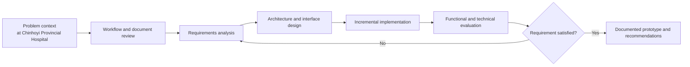
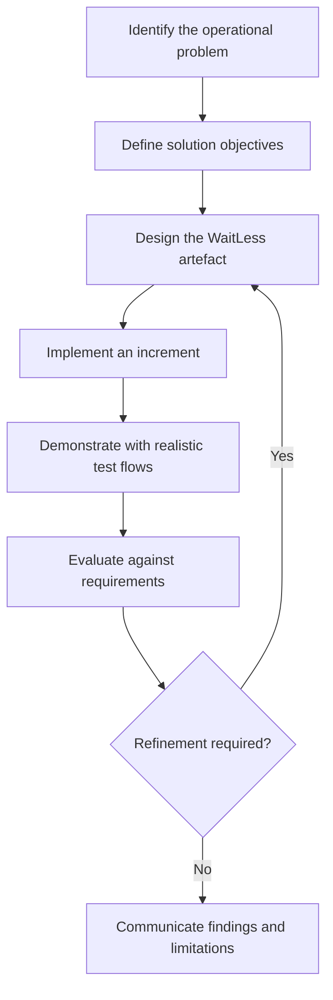
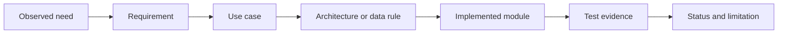

# Chapter 3: Methodology

## 3.0 Introduction

This chapter explains how the WaitLess project was investigated, designed, built, and evaluated. The work combined a single-site case study with design science research because the project had two connected goals: to understand a practical patient-flow problem in its real setting and to produce a working software artefact that responded to that problem. The methodology was deliberately iterative. Requirements were refined as hospital workflows became clearer, and each implemented module was checked against the problem it was intended to solve.

The chapter describes the research design, case selection, data sources, requirements-analysis procedure, development method, evaluation strategy, ethical safeguards, and limitations of the approach. It also distinguishes evidence gathered from the hospital context from results generated through prototype testing. This distinction was important because the project did not claim a full clinical deployment or a large-scale patient trial.

## 3.1 Research Philosophy and Approach

The project adopted a pragmatic research position. The central question was not whether one research tradition was universally preferable, but which combination of methods could produce a useful and defensible response to the queue-management problem. Qualitative evidence was used to understand workflow, roles, constraints, and exceptions. Quantitative measures were used where the prototype could be tested objectively, including automated-test results, build status, API behaviour, queue metrics, and response-time observations.

The overall approach was therefore an applied, mixed-evidence design rather than a statistical population study. The case-study evidence explained the local problem; design science guided the construction of the artefact; and software evaluation established what the prototype could and could not do.

## 3.2 Research Design

The research design combined three mutually supporting methods.

| Method | Purpose in the project | Main output |
|---|---|---|
| Single-site case study | To understand patient movement, triage, departmental hand-offs, and infrastructure constraints at Chinhoyi Provincial Hospital | Context-specific problem definition and workflow requirements |
| Design science research | To design and construct a useful software artefact in response to the observed problem | WaitLess web application, data model, queue logic, and notification workflow |
| Software-system evaluation | To test functional correctness, usability characteristics, security controls, build quality, and deployment suitability | Test results, requirements traceability, limitations, and recommendations |

The stages were connected rather than strictly linear. A workflow observation could lead to a revised requirement; a failed test could lead to an implementation change; and an implementation constraint could require a more realistic interpretation of the original requirement.

## 3.3 Design Science Research Method

Design science research was selected because the principal outcome was a software artefact designed to solve an identified organisational problem. Hevner et al. (2004) described design science as the creation and evaluation of purposeful artefacts, while Peffers et al. (2007) organised the method around problem identification, objectives, design and development, demonstration, evaluation, and communication. These stages closely matched the work carried out in WaitLess.

### 3.3.1 Problem Identification

The initial problem was expressed broadly as long and poorly coordinated queues. Case-study analysis refined it into several connected issues: registration and triage records were disconnected; queue position was not visible across departments; clinical urgency and arrival order had to be reconciled; patients could miss turns when they left a waiting area; and management lacked dependable operational data.

### 3.3.2 Objectives of the Artefact

The artefact was expected to provide one traceable patient-flow record from registration through triage and departmental service. It also had to preserve clinical priority, support anonymous public queue displays, provide role-appropriate staff controls, communicate queue events, and remain usable on an ordinary hospital local-area network.

### 3.3.3 Design and Development

The design was expressed through use cases, data-flow diagrams, an entity-relationship model, sequence diagrams, activity diagrams, access-control rules, and interface specifications. Development then proceeded by module, beginning with the queue core and extending into triage, dashboards, notifications, reporting, appointments, laboratory and pharmacy workflows, and administrative controls.

### 3.3.4 Demonstration and Evaluation

The prototype was demonstrated through realistic but non-identifying test records. Evaluation combined automated backend tests, manual end-to-end scenarios, production-build verification, API checks, interface review, requirements traceability, and a security-control review. Findings were used to separate completed behaviour from partially implemented or deployment-dependent behaviour.

## 3.4 Case Study and Unit of Analysis

Chinhoyi Provincial Hospital was selected purposively because it provided a realistic public-hospital setting with outpatient, casualty, diagnostic, pharmacy, and OI service streams. The hospital was not treated as a statistically representative sample of every Zimbabwean health facility. It was treated as a bounded case through which a context-appropriate artefact could be developed.

The main unit of analysis was the patient journey through the queue-management process. Supporting units included the registration desk, triage point, departmental queue, public display, notification event, staff action, and management report. This framing kept the project focused on coordination and waiting flow rather than attempting to replace a complete electronic health-record system.

## 3.5 Data Sources and Collection Methods

### 3.5.1 Direct Workflow Observation

Non-participant observation was used to understand how patients entered the hospital, moved between service points, and waited for the next action. Attention was given to hand-offs, decision points, repeated data entry, visible bottlenecks, and the difference between ordinary and urgent cases. Notes from this process informed the problem statement and the early use cases.

### 3.5.2 Hospital Workflow Artefacts

Available workflow artefacts were reviewed, including the OPD patient-flow map, colour-coded casualty triage categories, service-time indications, referral routes, and OI Clinic streams. These materials helped translate a general idea of a queue into concrete system states, department names, routing rules, and safety thresholds.

### 3.5.3 Literature and Policy Review

Published work on queueing theory, patient satisfaction, hospital waiting time, design science, electronic records, and e-health adoption was reviewed. Zimbabwe's National Health Strategy 2021-2025 was also considered to place the project within the wider direction of digital health and service improvement. Literature was used both to justify the problem and to challenge assumptions made during design.

### 3.5.4 Existing-System and Code Evidence

During implementation, evidence was also drawn from the system itself. API responses, audit events, test fixtures, queue-state transitions, notification attempts, production-build output, and source-code structure were examined. These sources supported technical evaluation but were not presented as clinical outcome data.

| Evidence source | Information extracted | Use in the project |
|---|---|---|
| Direct observation | Patient movement, waiting points, staff hand-offs | Problem definition and workflow modelling |
| OPD and triage artefacts | Stages, departments, priority categories, indicative times | Requirements and routing rules |
| OI service-flow information | ART, TB, viral-load, counselling, and screening streams | Confidential routing and module scope |
| Academic literature | Prior findings, research gap, evaluation approaches | Literature synthesis and methodological justification |
| Source code and API output | Implemented behaviour and constraints | Verification and traceability |
| Automated and manual tests | Pass/fail evidence and observed defects | Presentation of results |

## 3.6 Requirements Analysis Procedure

Requirements were derived through a traceable sequence. Observed workflow needs were first written as plain-language problems. Each problem was converted into a user or system requirement, assigned a priority, and mapped to one or more use cases. The corresponding design model was then linked to an implementation module and a test case.

For example, the observation that a critically ill patient could not be represented safely by a simple first-in-first-out line became a requirement for four-level triage priority. That requirement was reflected in the triage use case, queue-ordering rule, priority data field, dashboard presentation, and tests for call-next behaviour. This chain reduced the risk of adding attractive features that did not address the hospital problem.

Requirements were classified as functional or non-functional and prioritised as high, medium, or low. High-priority work covered registration, triage, queue ordering, staff authentication, anonymous public display, and operational traceability. Lower-priority analytics and deployment enhancements were implemented only after the core patient-flow path was stable.

## 3.7 System Development Method

An iterative and incremental development method was used. A rigid single-pass process would have been poorly suited to a project in which queue rules, interface behaviour, and deployment assumptions were clarified during construction. Work was organised into short feature increments, each of which passed through clarification, design, implementation, verification, and review.

The main increments were:

1. Patient registration, ticket generation, and basic queue state.
2. Digital triage and priority-aware queue ordering.
3. Staff dashboard, call-next actions, missed turns, recall, and transfer.
4. Patient tracking, public queue boards, and department displays.
5. Notification logging, retry handling, and delivery analytics.
6. Reports, audit history, appointments, pharmacy, laboratory, and OI support.
7. Authentication hardening, profile management, navigation, and deployment preparation.

Version control was used to preserve implementation history. Reusable components and service boundaries were preferred so that changes to one workflow did not require unrelated pages to be rewritten. Defects found during testing were corrected within the same increment where practical; unresolved work was recorded as a limitation or future recommendation.

## 3.8 Technology Selection Procedure

Technology choices were judged against the project context rather than popularity alone. The frontend required responsive, component-based interfaces capable of frequent state updates. The backend required lightweight concurrent connections, structured APIs, and real-time event delivery. Data storage had to support a production relational database while retaining a simple development mode. The selected React, Node.js, Express, Server-Sent Events, and MySQL-oriented architecture met these needs and matched the skills and hardware available to the project team.

Other criteria included maintainability, licence cost, local development support, browser compatibility, and the ability to deploy on a hospital LAN. The detailed justification and resulting architecture are presented in Chapter 4.

## 3.9 Evaluation Strategy

Evaluation was structured around the three project objectives.

| Objective | Evaluation question | Evidence used |
|---|---|---|
| Analyse the existing workflow | Were the important actors, stages, priorities, and constraints represented? | Case-study notes, workflow artefacts, requirements catalogue, use cases |
| Design and develop the system | Did the prototype implement the required patient-flow and staff-control behaviour? | Source-code inspection, API verification, automated tests, manual scenarios, build output |
| Evaluate suitability | Was the prototype understandable, responsive, secure enough for demonstration, and realistic for constrained deployment? | Interface review, task scenarios, performance observations, security checklist, limitation analysis |

### 3.9.1 Functional Testing

Backend unit tests checked queue ordering, registration, status transitions, notification retries, authentication-related behaviour, and report calculations. Manual tests exercised cross-page journeys such as registration to triage, call-next to patient tracking, missed turn to recall, and notification failure to retry.

### 3.9.2 Usability Evaluation

Usability was examined through task-based walkthroughs and responsive interface inspection. The System Usability Scale questionnaire was prepared as a repeatable instrument for pilot users; however, the documentation did not present an invented population score where a formal sample had not been completed. Interface findings were therefore reported as prototype evidence rather than as a hospital-wide usability claim.

### 3.9.3 Performance and Reliability Evaluation

The frontend production build, API response behaviour, real-time update path, and persistence modes were checked. Low-bandwidth suitability was considered through asset size, browser-based deployment, local-network operation, and graceful notification failure. Full production load testing with hospital-scale concurrent users remained future work.

### 3.9.4 Security Evaluation

The evaluation reviewed password hashing, session handling, role checks, audit logging, public-display privacy, consent, input validation, and configuration risks. Security findings were documented honestly: prototype controls that were present were distinguished from deployment controls that still required production secrets, hardened hosting, rate limiting, backup procedures, and operational monitoring.

## 3.10 Data Analysis

Qualitative evidence was analysed thematically. Observations and workflow materials were grouped into recurring concerns such as registration delay, triage safety, department hand-off, missed turns, visibility, reporting, confidentiality, and infrastructure. These themes became requirement groups and later provided categories for evaluating the prototype.

Quantitative prototype evidence was summarised descriptively. Counts, percentages, waiting-time calculations, test pass rates, build sizes, and notification statuses were reported without implying statistical generalisation beyond the tested data. Where real hospital baseline data were unavailable, the report stated that limitation instead of constructing unsupported before-and-after claims.

## 3.11 Validity, Reliability, and Trustworthiness

Several measures were used to strengthen the study. Requirements were triangulated across observation, hospital workflow artefacts, literature, and the implemented system. A requirements-traceability matrix connected needs to tests. Repeatable automated tests reduced dependence on a single manual demonstration. Diagrams, API contracts, and data definitions made design decisions inspectable by another developer or supervisor.

Threats remained. The single-case design limited generalisation, observation could miss infrequent events, and prototype test data could not reproduce every clinical or organisational condition. These limitations were mitigated by avoiding claims of clinical effectiveness and by presenting future pilot evaluation as a necessary next step.

## 3.12 Ethical and Privacy Considerations

The project dealt with healthcare workflows and therefore applied privacy-by-design principles even though it remained a prototype. Demonstration records used synthetic identities. Public queue boards displayed ticket numbers rather than patient names. Staff actions were attributed through authenticated accounts, sensitive routes were role-protected, notification consent was recorded, and OI-related information was treated as confidential.

No diagnosis or treatment decision was delegated to the software. Triage logic supported authorised staff and provided escalation cues; it did not replace clinical judgement. Formal hospital approval, production data-governance agreements, and patient-participant consent would be required before live clinical deployment or a patient outcome study.

## 3.13 Implementation Plan and Milestones

The implementation plan was organised around observable deliverables and completion criteria, as required by the project guide.

| Milestone | Deliverable | Completion criterion | Target period |
|---|---|---|---|
| Problem analysis | Case-study notes and problem statement | Core workflow and constraints documented | March-April 2026 |
| Requirements | Prioritised functional and non-functional requirements | Requirements reviewed and mapped to actors | April-May 2026 |
| System design | Architecture, ERD, DFDs, use cases, sequences, and activity models | Major workflows represented consistently | May-June 2026 |
| Core implementation | Registration, triage, queues, dashboards, tracking | End-to-end patient flow demonstrable | June-July 2026 |
| Extended implementation | Notifications, reports, appointments, department modules | Priority features integrated with the queue core | July-August 2026 |
| Verification | Automated tests, manual scenarios, build and security review | Critical test paths pass and limitations are recorded | August 2026 |
| Documentation | Dissertation, diagrams, user guides, and deployment notes | Submission package generated and reviewed | August 2026 |
| Pilot preparation | UAT plan, deployment checklist, training material | Ready for authorised hospital pilot | Post-submission |

Project deliverables included the frontend and backend source code, database schema, environment templates, automated tests, system diagrams, deployment guidance, patient and staff user manuals, and the completed dissertation.

## 3.14 Methodological Limitations

The methodology produced a well-documented prototype, but it did not substitute for a controlled clinical evaluation. The project did not have a sufficiently large verified dataset to measure a statistically reliable reduction in hospital waiting time. It also did not complete a representative survey of patients and staff. External services such as WhatsApp and web push required production credentials and provider configuration that could not be fully validated in an offline demonstration environment.

These limitations shaped the conclusions. The project could demonstrate functional feasibility, traceable design, and readiness for pilot preparation; it could not yet claim population-level patient satisfaction, long-term operational savings, or improved clinical outcomes.

## 3.15 Chapter Summary

This chapter described the pragmatic case-study and design science methodology used to develop WaitLess. The method connected observed workflow problems to requirements, design models, implementation modules, and test evidence. It also established the boundaries of the evaluation so that the final claims remained proportional to the evidence. Chapter 4 presents the resulting system design and implementation in detail.
