# Chapter 3: System Analysis and Design

## 3.1 Introduction

This chapter presents a comprehensive analysis and design of the WaitLess Digital Queue Management System. It details the functional and non-functional requirements, use case modelling, system architecture, data design, process flows, user interface design, and security design. The analysis is grounded in the actual implementation of the system, which has been built and verified against an 83-feature requirements traceability matrix.

The system was designed for Chinhoyi Provincial Hospital in Zimbabwe, with the goal of replacing manual queue management with a real-time, web-based solution that streamlines patient flow from registration through triage, service delivery, and completion.

---

## 3.2 Requirements Analysis

### 3.2.1 Functional Requirements

The functional requirements are organised by module, with each requirement assigned a unique identifier consistent with the project's amendments and traceability audit.

#### Module 1: Patient Registration

| ID | Requirement | Priority | Status |
|----|-------------|----------|--------|
| 1.1 | The system shall allow staff to electronically register patients with demographics, national ID, phone, address, category, next of kin, chief complaint, department, and notification consent. | High | Complete |
| 1.2 | The system shall support returning-patient search by name, phone, national ID, patient number, previous ticket, or scanned QR code, and reuse existing records without duplication. | High | Complete |
| 1.3 | The system shall generate a unique, immutable queue token (e.g., OPD-205, LAB-206) consistent across print, phone, WhatsApp, and display board. | High | Complete |
| 1.4 | The system shall generate a QR patient card for self-service identification and reception lookup. | Medium | Partial |
| 1.5 | The system shall classify patients by category: walk-in, referred, emergency, elderly, pregnant, child, disabled, and chronic-care. | Medium | Complete |

#### Module 2: Patient Self-Service

| ID | Requirement | Priority | Status |
|----|-------------|----------|--------|
| 2.1 | The system shall allow online pre-registration with arrival activation by reception staff. | Medium | Partial |
| 2.2 | The system shall provide a self-service kiosk for check-in by QR code scan or phone number lookup, collecting department and visit reason, and issuing a queue token. | High | Complete |
| 2.3 | The system shall provide a live patient queue-status tracking page showing token, department, position, patients ahead, ETA, progress, directions, and notification history. | High | Complete |
| 2.4 | The system shall provide a patient feedback form for satisfaction, cleanliness, communication, and wait-time feedback. | Low | Not Started |

#### Module 3: Triage

| ID | Requirement | Priority | Status |
|----|-------------|----------|--------|
| 3.1 | The system shall support digital triage assessment capturing chief complaint, symptoms, vitals (oxygen saturation, heart rate, blood pressure, temperature, respiratory rate), pain score, and severity. | High | Complete |
| 3.2 | The system shall classify patients into four priority levels: Red (Critical), Yellow (Serious), Green (Ambulant), and Black (Deceased). | High | Complete |
| 3.3 | The system shall automatically fast-track Red priority cases based on emergency vital thresholds and trigger escalation alerts. | High | Complete |
| 3.4 | The system shall generate reassessment alerts for Red and Yellow patients who have been waiting beyond defined thresholds. | High | Complete |
| 3.5 | The system shall allow authorised triage staff to manually override the priority assignment, recording the before/after priority and the staff actor. | High | Complete |

#### Module 4: Queue Management

| ID | Requirement | Priority | Status |
|----|-------------|----------|--------|
| 4.1 | The system shall automatically assign patients to a department queue after registration or triage. | High | Partial |
| 4.2 | The system shall maintain department-specific queues for OPD, Casualty/Triage, Pharmacy, Laboratory, Radiology, and OI Clinic. | High | Complete |
| 4.3 | The system shall call the next patient by priority (Red > Yellow > Green > Black), then by arrival time, within a selected department. | High | Complete |
| 4.4 | The system shall mark a called patient as missed if they do not present for service. | High | Complete |
| 4.5 | The system shall support fair recall of missed patients with configurable reinsertion rules. | Medium | Partial |
| 4.6 | The system shall support queue transfer of a patient to another department with patient notification. | High | Complete |
| 4.7 | The system shall calculate dynamic estimated waiting time based on historical service time and queue position. | Medium | Partial |
| 4.8 | The system shall detect and display queue bottlenecks based on department load and thresholds. | Medium | Partial |

#### Module 5: Department Routing

| ID | Requirement | Priority | Status |
|----|-------------|----------|--------|
| 5.1 | The system shall support automatic department routing based on chief complaint keyword matching. | Medium | Partial |
| 5.2 | The system shall support doctor-to-laboratory test order workflow with lifecycle states (ordered, sample-collected, in-progress, completed, result-ready). | Medium | Partial |
| 5.3 | The system shall support doctor-to-pharmacy prescription workflow with lifecycle states (prescribed, dispensing, ready, collected). | Medium | Partial |
| 5.4 | The system shall support OI Clinic service streams (ART, TB, viral load, counselling, screening). | Low | Not Started |

#### Module 6: Staff Dashboard

| ID | Requirement | Priority | Status |
|----|-------------|----------|--------|
| 6.1 | The system shall provide a live queue dashboard with real-time metrics, queue tables, patient actions, alerts, and automatic refresh. | High | Complete |
| 6.2 | The system shall provide department-scoped dashboards that filter data by staff department assignment. | Medium | Complete |
| 6.3 | The system shall provide an administrator dashboard with staff management, audit trail, queue overview, reports, and settings. | High | Complete |
| 6.4 | The system shall display operational alerts including critical metrics, reassessment alerts, and notification failures. | Medium | Partial |

#### Module 7: Notifications

| ID | Requirement | Priority | Status |
|----|-------------|----------|--------|
| 7.1 | The system shall send WhatsApp notifications for registration, turn readiness, call, missed turn, and transfer events. | High | Partial |
| 7.2 | The system shall support web push notifications. | Low | Not Started |
| 7.3 | The system shall provide automatic and manual notification retry with configurable retry delays and attempt limits. | High | Complete |
| 7.4 | The system shall maintain a notification delivery log with status, timestamps, provider message ID, and error details. | High | Complete |
| 7.5 | The system shall send a missed-turn notification when a called ticket is marked missed. | High | Complete |

#### Module 8: Queue Display Screens

| ID | Requirement | Priority | Status |
|----|-------------|----------|--------|
| 8.1 | The system shall provide a public waiting-area display board showing now-serving, waiting, and missed token numbers without patient names. | High | Complete |
| 8.2 | The system shall provide department-specific display boards accessible via URL with department query parameter. | Medium | Complete |
| 8.3 | The system shall support audio calling of token numbers. | Low | Not Started |

#### Module 9: Reporting

| ID | Requirement | Priority | Status |
|----|-------------|----------|--------|
| 9.1 | The system shall generate a daily report by department, service, gender, age, and triage priority. | Medium | Not Started |
| 9.2 | The system shall generate an average waiting time report by department with date filtering. | High | Complete |
| 9.3 | The system shall generate a department performance report with throughput, missed rate, and priority breakdown. | High | Complete |
| 9.4 | The system shall generate a no-show report with notification delivery correlation per missed ticket. | High | Complete |
| 9.5 | The system shall generate a triage report with triage rate, timing, outcomes, overrides, and trends. | High | Complete |
| 9.6 | The system shall support PDF, Excel, and CSV export of reports. | Low | Not Started |

#### Module 10: Analytics

| ID | Requirement | Priority | Status |
|----|-------------|----------|--------|
| 10.1 | The system shall provide peak-hours analysis of patient arrivals and service patterns. | Low | Not Started |
| 10.2 | The system shall provide queue-congestion prediction. | Low | Not Started |
| 10.3 | The system shall provide resource-allocation suggestions based on current load. | Low | Not Started |

#### Module 11: Security and Access Control

| ID | Requirement | Priority | Status |
|----|-------------|----------|--------|
| 11.1 | The system shall enforce role-based access control with roles: admin, reception, triage, and clinician. | High | Complete |
| 11.2 | The system shall provide secure individual login with bcrypt password hashing and action attribution. | High | Complete |
| 11.3 | The system shall maintain an immutable, hash-chained audit trail of all operational actions. | High | Complete |
| 11.4 | The system shall implement automatic idle logout with inactivity timeout. | Medium | Not Started |

#### Module 12: Privacy and Confidentiality

| ID | Requirement | Priority | Status |
|----|-------------|----------|--------|
| 12.1 | The system shall display anonymous token numbers on public displays, never patient names. | High | Complete |
| 12.2 | The system shall capture and honour notification consent preferences. | High | Complete |
| 12.3 | The system shall provide confidential OI mode with masked routing and restricted data views. | Low | Not Started |

#### Module 13: Offline and Connectivity

| ID | Requirement | Priority | Status |
|----|-------------|----------|--------|
| 13.1 | The system shall support local-network hosting within a hospital LAN. | Medium | Partial |
| 13.2 | The system shall maintain core queue operation without internet connectivity. | Medium | Partial |
| 13.3 | The system shall queue notifications for delivery when internet connectivity returns. | Medium | Partial |
| 13.4 | The system shall provide local form auto-save with IndexedDB draft recovery. | Low | Not Started |

#### Module 14–21: Additional Modules

Additional modules covering Appointment Management, OI Clinic, Pharmacy, Laboratory/Radiology, Staff Management, Patient Experience, Global System Features, and AI/Smart Assistance are defined in the project amendments. Their current implementation status is documented in the traceability matrix (Section 3.2.3).

### 3.2.2 Non-Functional Requirements

| ID | Category | Requirement |
|----|----------|-------------|
| NFR-01 | Performance | The system shall load the public queue board within 3 seconds on a standard hospital LAN connection. |
| NFR-02 | Performance | The system shall deliver real-time queue updates to connected clients within 2 seconds of a state change via Server-Sent Events. |
| NFR-03 | Performance | The frontend production build shall not exceed 3 MB uncompressed (current: 2.49 MB). |
| NFR-04 | Security | All passwords shall be hashed using bcrypt with a minimum cost factor of 12. |
| NFR-05 | Security | Staff sessions shall expire after 8 hours of inactivity. |
| NFR-06 | Security | The audit trail shall be tamper-evident using SHA-256 hash chaining. |
| NFR-07 | Security | Public displays shall never expose patient names or personally identifiable information. |
| NFR-08 | Usability | The system shall be usable on desktop, tablet, and mobile devices with responsive design. |
| NFR-09 | Usability | The system shall use a consistent visual language with medical teal (#0F766E) as the primary brand colour. |
| NFR-10 | Reliability | The system shall persist all queue state to the database, surviving server restarts without data loss. |
| NFR-11 | Reliability | The system shall support dual-mode storage (MySQL or file-based JSON) for deployment flexibility. |
| NFR-12 | Scalability | The system shall support concurrent connections from at least 50 staff and display board clients. |
| NFR-13 | Maintainability | The system shall use a modular architecture with clear separation of concerns (controller, service, repository layers). |
| NFR-14 | Maintainability | The system shall use a component-based frontend architecture with reusable UI components. |
| NFR-15 | Compatibility | The system shall run on Node.js v18+ and modern browsers (Chrome, Firefox, Edge, Safari). |

### 3.2.3 User Requirements by Stakeholder Role

| Role | Key Requirements |
|------|-----------------|
| **Patient** | Register online or at kiosk; receive a queue token; track queue status in real-time; receive WhatsApp notifications; view estimated wait time; leave and return without losing position. |
| **Reception Staff** | Register new and returning patients; search patient records; scan QR codes; manage queue tokens; transfer patients between departments; view department-scoped queue. |
| **Triage Nurse** | Conduct digital triage assessments; assign priority levels; override automatic classifications; view reassessment alerts; fast-track emergency cases. |
| **Clinician/Doctor** | Call next patient by priority; mark patients as in-service or completed; prescribe medications; order laboratory tests; transfer patients; view department dashboard. |
| **Administrator** | Manage staff accounts and roles; view system-wide audit trail; access all reports and analytics; configure system settings; manage departments. |
| **Hospital Manager** | View department performance reports; monitor waiting times and no-show rates; review triage outcomes; assess notification delivery effectiveness. |

---

## 3.3 Use Case Diagrams

### 3.3.1 System-Wide Use Case Diagram

```mermaid
graph TB
    Patient((Patient))
    Reception((Reception Staff))
    TriageNurse((Triage Nurse))
    Clinician((Clinician))
    Admin((Administrator))

    Patient --> UC1[Register Online / Self-Check-in]
    Patient --> UC2[Track Queue Status]
    Patient --> UC3[Receive Notifications]
    Patient --> UC4[View Patient Portal]

    Reception --> UC5[Register Patient]
    Reception --> UC6[Search Returning Patient]
    Reception --> UC7[Scan QR Code]
    Reception --> UC8[Transfer Patient]
    Reception --> UC9[Confirm Arrival]

    TriageNurse --> UC10[Assess Triage]
    TriageNurse --> UC11[Assign Priority]
    TriageNurse --> UC12[Override Priority]

    Clinician --> UC13[Call Next Patient]
    Clinician --> UC14[Mark Missed Turn]
    Clinician --> UC15[Recall Patient]
    Clinician --> UC16[Prescribe Medication]
    Clinician --> UC17[Order Lab Test]
    Clinician --> UC18[Complete Service]

    Admin --> UC19[Manage Staff]
    Admin --> UC20[View Audit Trail]
    Admin --> UC21[View Reports]
    Admin --> UC22[Configure System]

    UC1 --> System((WaitLess System))
    UC5 --> System
    UC10 --> System
    UC13 --> System
    UC19 --> System
```

### 3.3.2 Patient Registration Use Case Diagram

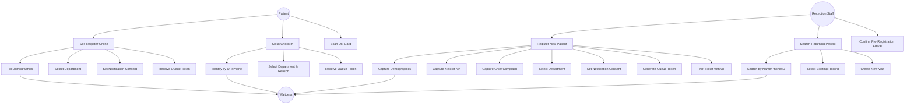

### 3.3.3 Triage Use Case Diagram

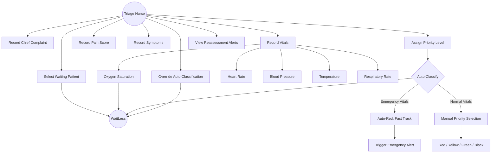

### 3.3.4 Queue Management Use Case Diagram

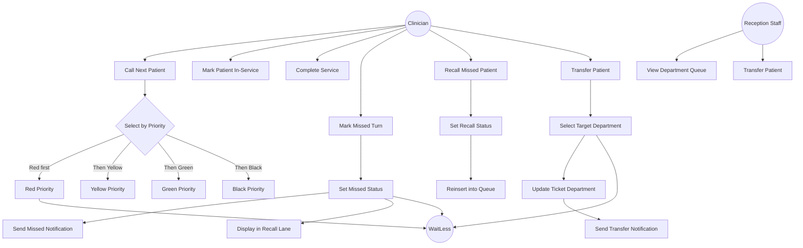

### 3.3.5 Notification Use Case Diagram

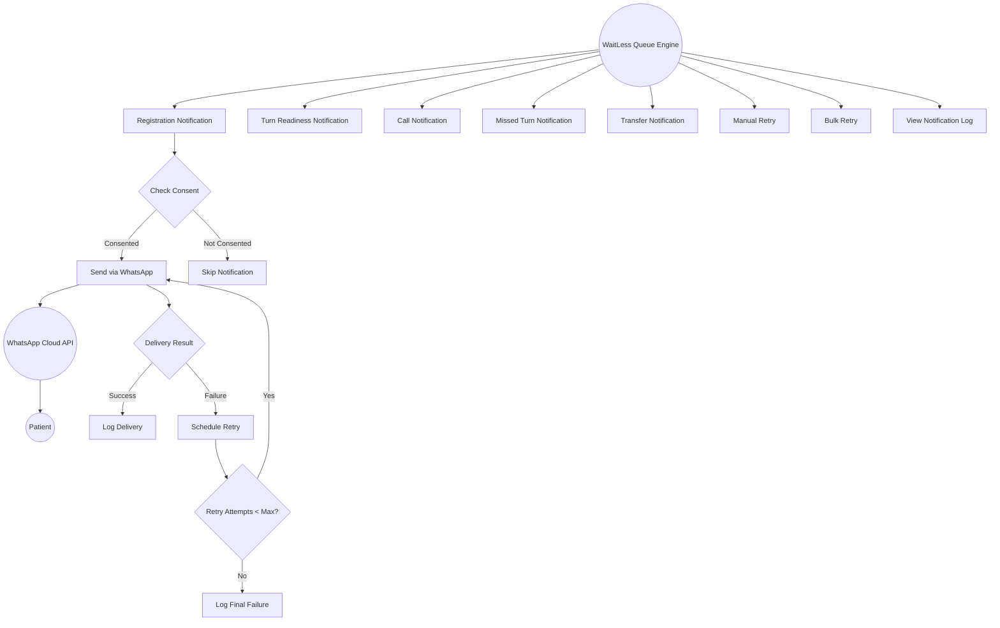

---

## 3.4 Use Case Descriptions

### Use Case UC-01: Register New Patient

| Field | Description |
|-------|-------------|
| **Use Case ID** | UC-01 |
| **Use Case Name** | Register New Patient |
| **Actor(s)** | Reception Staff |
| **Description** | A reception staff member registers a new patient entering the hospital, capturing demographics, next of kin, chief complaint, and department selection. The system generates a unique queue token and prints a ticket. |
| **Preconditions** | Staff member is authenticated with reception role. Department queue is operational. |
| **Postconditions** | Patient is registered in the system. A queue ticket is created with a unique token. Patient appears in the department waiting queue. |
| **Main Flow** | 1. Staff selects "Register Patient" from the dashboard. 2. Staff enters patient demographics (name, national ID, DOB, gender, phone, address). 3. Staff selects patient category (walk-in, referred, emergency, etc.). 4. Staff enters next of kin details. 5. Staff enters chief complaint. 6. Staff selects destination department. 7. Staff sets notification consent (WhatsApp opt-in). 8. Staff submits the form. 9. System validates inputs. 10. System creates or links a patient profile. 11. System generates a department-specific queue token (e.g., OPD-205). 12. System creates a ticket with status "waiting" and priority "green". 13. System broadcasts a queue update event via SSE. 14. System sends a registration WhatsApp notification if consented. 15. System displays the ticket with QR code for printing. |
| **Alternate Flows** | **A1: Returning patient found.** At step 10, if a matching patient profile is found by name, phone, or national ID, the system links to the existing profile instead of creating a new one. **A2: Validation error.** At step 9, if required fields are missing or invalid, the system displays validation errors and the staff corrects the input. |
| **Exceptions** | **E1: Database unavailable.** If the database is unreachable, the system falls back to file-based storage (if configured) or displays an error message. |
| **Business Rules** | Queue tokens are immutable once generated. Token prefixes are department-specific (OPD, TRI, PHA, LAB, RAD, OIC). Sequence numbers are persistent and monotonic. |
| **Frequency** | High — performed many times daily. |

### Use Case UC-02: Triage Assessment

| Field | Description |
|-------|-------------|
| **Use Case ID** | UC-02 |
| **Use Case Name** | Triage Assessment |
| **Actor(s)** | Triage Nurse |
| **Description** | A triage nurse conducts a structured assessment of a waiting patient, recording vitals, symptoms, pain score, and severity. The system auto-classifies priority based on emergency vital thresholds, with manual override capability. |
| **Preconditions** | Patient exists in the queue with status "waiting". Triage nurse is authenticated with triage role. |
| **Postconditions** | Patient's priority is updated. Triage assessment is recorded with assessor identity and timestamp. If Red priority, emergency fast-tracking is triggered. Queue order is updated. |
| **Main Flow** | 1. Nurse selects a waiting patient from the triage queue. 2. Nurse records chief complaint (if not already captured). 3. Nurse records vitals: oxygen saturation, heart rate, blood pressure (systolic/diastolic), temperature, respiratory rate. 4. Nurse records pain score (0–10). 5. Nurse records symptoms and severity notes. 6. System evaluates vitals against emergency thresholds. 7. If any vital exceeds emergency thresholds, system auto-assigns Red priority. 8. If no emergency thresholds are exceeded, nurse manually selects priority (Red/Yellow/Green/Black). 9. System saves the triage assessment with assessor ID and timestamp. 10. System updates the patient's priority in the queue. 11. If Red priority, system triggers emergency fast-tracking (moves patient to front of queue). 12. System broadcasts a queue update event via SSE. 13. System records an audit event with before/after priority. |
| **Alternate Flows** | **A1: Manual override.** At step 8, the nurse may override an auto-Red classification if clinical judgement differs. The override is recorded with the original and new priority. **A2: Patient already triaged.** If the patient has a prior triage assessment, the nurse can update it, and both the original and updated values are retained. |
| **Exceptions** | **E1: Patient not found.** If the selected patient no longer exists in the queue, the system displays an error and returns to the triage list. |
| **Business Rules** | Emergency vital thresholds: SpO2 < 90%, HR outside 40–130 bpm, systolic BP outside 80–180 mmHg, temperature >= 39.5°C, respiratory rate outside 8–30/min, pain score >= 9. Priority order: Red (0) > Yellow (1) > Green (2) > Black (3). |
| **Frequency** | High — performed for every Casualty/Triage patient. |

### Use Case UC-03: Call Next Patient

| Field | Description |
|-------|-------------|
| **Use Case ID** | UC-03 |
| **Use Case Name** | Call Next Patient |
| **Actor(s)** | Clinician |
| **Description** | A clinician calls the next patient in their department queue. The system selects the highest-priority, longest-waiting patient and updates their status to "called". |
| **Preconditions** | Clinician is authenticated. At least one patient is waiting in the department queue. |
| **Postconditions** | Selected patient's status is "called". Patient is removed from the waiting list. A call notification is sent if consented. Queue display boards update in real-time. |
| **Main Flow** | 1. Clinician clicks "Call Next" on the dashboard. 2. System retrieves all waiting tickets for the clinician's department. 3. System sorts by priority rank (Red first), then by registration time (earliest first). 4. System selects the top ticket. 5. System updates the ticket status to "called" and records the called_at timestamp. 6. System broadcasts a "ticket.called" event via SSE. 7. System sends a WhatsApp call notification if the patient consented. 8. System dispatches turn-readiness notifications for remaining waiting patients. 9. System displays the called patient's details to the clinician. |
| **Alternate Flows** | **A1: No waiting patients.** If no patients are waiting in the department, the system displays "No patients waiting" and no action is taken. |
| **Exceptions** | **E1: Concurrent call.** If two clinicians call next simultaneously, the system processes requests sequentially; the second clinician receives the next available patient. |
| **Business Rules** | Priority sorting: Red > Yellow > Green > Black. Within the same priority, earliest registration time is called first. Called patients have a configurable window before being marked missed. |
| **Frequency** | High — performed continuously during clinic hours. |

### Use Case UC-04: Missed Turn and Recall

| Field | Description |
|-------|-------------|
| **Use Case ID** | UC-04 |
| **Use Case Name** | Mark Missed Turn and Recall |
| **Actor(s)** | Clinician |
| **Description** | A clinician marks a called patient as missed when they do not present for service. The patient is moved to a recall lane. The clinician can later recall the patient, reinserting them into the queue. |
| **Preconditions** | Patient has status "called". |
| **Postconditions** | Patient status is "missed". Missed notification is sent. Patient appears in the recall lane. On recall, patient is reinserted into the waiting queue. |
| **Main Flow** | 1. Clinician selects a called patient and clicks "Mark Missed". 2. System updates the ticket status to "missed" and records the missed_at timestamp. 3. System broadcasts a "ticket.missed" event via SSE. 4. System sends a missed-turn WhatsApp notification if consented. 5. Patient appears in the missed/recall lane on the dashboard and display board. 6. When the patient returns, clinician clicks "Recall". 7. System updates the ticket status to "waiting" and records the recalled_at timestamp. 8. System increments the recall count. 9. System reinserts the patient into the waiting queue. 10. System broadcasts a "ticket.recalled" event via SSE. |
| **Alternate Flows** | **A1: Configurable reinsertion.** The reinsertion position can be configured (e.g., after 3 patients) to balance fairness with flow. |
| **Business Rules** | Recall count is tracked per ticket. Multiple recalls are allowed. The registration time may be reset on recall depending on configuration. |
| **Frequency** | Medium — occurs when patients step away during their turn. |

### Use Case UC-05: Queue Transfer

| Field | Description |
|-------|-------------|
| **Use Case ID** | UC-05 |
| **Use Case Name** | Transfer Patient Between Departments |
| **Actor(s)** | Clinician, Reception Staff |
| **Description** | A staff member transfers a patient from one department queue to another, recording the previous department and notifying the patient. |
| **Preconditions** | Patient exists in the queue with a non-completed status. Target department is valid. |
| **Postconditions** | Patient's department is updated. Previous department is recorded. Transfer notification is sent. Patient appears in the target department's waiting queue. |
| **Main Flow** | 1. Staff selects a patient and clicks "Transfer". 2. Staff selects the target department from the dropdown. 3. System validates the target department exists. 4. System records the previous department. 5. System updates the ticket's department and sets transferred_at timestamp. 6. System broadcasts a "ticket.transferred" event via SSE. 7. System sends a transfer WhatsApp notification with the new department and directions. 8. System dispatches turn-readiness notifications for the updated queue. |
| **Alternate Flows** | None. |
| **Exceptions** | **E1: Invalid department.** If the target department is the same as the current department or does not exist, the system displays an error. |
| **Business Rules** | Only non-completed tickets can be transferred. The previous department is retained for audit and tracking purposes. |
| **Frequency** | Medium — occurs when patients need services in multiple departments. |

### Use Case UC-06: Patient Self-Tracking

| Field | Description |
|-------|-------------|
| **Use Case ID** | UC-06 |
| **Use Case Name** | Track Queue Status |
| **Actor(s)** | Patient |
| **Description** | A patient enters their queue token on the public tracking page to view their current queue position, estimated wait time, patients ahead, and notification history. |
| **Preconditions** | Patient has a valid queue token. |
| **Postconditions** | Patient views their current queue status. No state changes occur. |
| **Main Flow** | 1. Patient navigates to the tracking page (/track). 2. Patient enters their queue token (e.g., OPD-205). 3. System looks up the ticket by normalised token code. 4. System retrieves the ticket's current status, department, priority, and position. 5. System calculates the estimated wait time based on historical service time and queue position. 6. System retrieves the patient's notification history. 7. System displays: token, department, current status, position in queue, patients ahead, estimated wait time, progress indicator, and department directions. 8. Page updates in real-time via SSE when queue state changes. |
| **Alternate Flows** | **A1: Token not found.** If the token does not match any ticket, the system displays "Ticket not found" and prompts re-entry. |
| **Exceptions** | None. |
| **Business Rules** | Tracking is public and does not require authentication. Only the token code is needed. Patient name is not displayed on the tracking page for privacy. |
| **Frequency** | High — patients check frequently during their wait. |

### Use Case UC-07: Kiosk Self-Check-in

| Field | Description |
|-------|-------------|
| **Use Case ID** | UC-07 |
| **Use Case Name** | Kiosk Self-Check-in |
| **Actor(s)** | Patient |
| **Description** | A patient uses a self-service kiosk to check in by scanning a QR card or entering a phone number, selecting a department and visit reason, and receiving a queue token. |
| **Preconditions** | Kiosk device is operational and connected to the network. |
| **Postconditions** | Patient is checked in. A queue ticket is created. Patient receives a token and optional WhatsApp notifications. |
| **Main Flow** | 1. Patient approaches the kiosk and taps "Check In". 2. Patient identifies themselves by scanning a QR card (camera-based) or entering a phone number. 3. System searches for an existing patient profile by QR payload or phone. 4. If found, system displays the patient's name for confirmation. 5. If not found, patient enters basic demographics. 6. Patient selects the destination department. 7. Patient enters a visit reason / chief complaint. 8. Patient sets notification consent. 9. System creates a queue ticket with the next sequence number. 10. System displays the queue token and estimated wait time. 11. System broadcasts a queue update event via SSE. 12. System sends a registration notification if consented. |
| **Alternate Flows** | **A1: QR scan failure.** If the camera cannot read the QR code, the patient can manually enter their phone number or patient number. |
| **Exceptions** | **E1: Network error.** If the kiosk cannot reach the server, an error message is displayed and the patient is directed to reception. |
| **Business Rules** | Kiosk check-in creates a "waiting" ticket with "green" priority by default. Triage assessment can upgrade the priority later. |
| **Frequency** | Medium — used by walk-in patients at the hospital entrance. |

### Use Case UC-08: Send WhatsApp Notification

| Field | Description |
|-------|-------------|
| **Use Case ID** | UC-08 |
| **Use Case Name** | Send WhatsApp Notification |
| **Actor(s)** | System (automated) |
| **Description** | The system sends a WhatsApp message to a patient for registration, turn readiness, call, missed turn, or transfer events, with automatic retry on failure. |
| **Preconditions** | Patient has notification consent enabled. Patient has a valid phone number. WhatsApp provider is configured (mock or Meta Cloud API). |
| **Postconditions** | Notification record is created with delivery status. If successful, message is delivered. If failed, retry is scheduled. |
| **Main Flow** | 1. A queue event triggers notification dispatch (registration, call, missed, transfer, turn readiness). 2. System checks the patient's notification consent. 3. System creates a notification record with type, channel, recipient, and message content. 4. System resolves the WhatsApp template for the notification type. 5. System sends the message via the configured provider (mock or Meta Cloud API). 6. If delivery succeeds, system records the provider message ID and sets status to "sent"/"delivered". 7. If delivery fails, system records the error code and message, and schedules a retry based on configured retry delays (15s, 60s, 300s). 8. System creates a notification attempt record for each attempt. 9. Retry continues until max attempts is reached or delivery succeeds. |
| **Alternate Flows** | **A1: Manual retry.** Staff can manually retry a failed notification from the dashboard. **A2: Bulk retry.** Staff can retry multiple failed notifications simultaneously. |
| **Exceptions** | **E1: Provider unavailable.** If the WhatsApp API is unreachable, the notification is queued for retry. **E2: Invalid phone number.** If the phone number is invalid, the notification is marked as failed with an error code. |
| **Business Rules** | Retry delays: 15 seconds, 60 seconds, 300 seconds (configurable). Max attempts: configurable per notification. Mock provider simulates delivery with configurable delay and failure rate for development. |
| **Frequency** | High — triggered by every queue event for consented patients. |

### Use Case UC-09: View Reports

| Field | Description |
|-------|-------------|
| **Use Case ID** | UC-09 |
| **Use Case Name** | View Operational Reports |
| **Actor(s)** | Administrator, Clinician |
| **Description** | A staff member views operational reports including average waiting time, department performance, no-show analysis, triage outcomes, and WhatsApp status, with date range filtering. |
| **Preconditions** | Staff member is authenticated. |
| **Postconditions** | Report data is displayed. No state changes occur. |
| **Main Flow** | 1. Staff navigates to the Reports page. 2. Staff selects a report tab (Overview, Average Wait Time, Department Performance, No-Show, Triage, WhatsApp Status). 3. Staff selects a date range (from/to). 4. System fetches report data from the API with date filters. 5. System displays the report with summary metrics, department breakdowns, and detailed tables. |
| **Alternate Flows** | None. |
| **Exceptions** | **E1: No data.** If no tickets exist in the selected date range, the system displays an empty state message. |
| **Business Rules** | Reports are read-only. Date filtering applies to ticket registration date. Department scoping applies to non-admin staff. |
| **Frequency** | Medium — used for daily/weekly operational review. |

### Use Case UC-10: View Audit Trail

| Field | Description |
|-------|-------------|
| **Use Case ID** | UC-10 |
| **Use Case Name** | View Audit Trail |
| **Actor(s)** | Administrator |
| **Description** | An administrator views the immutable audit trail of all system actions, including actor, timestamp, action type, entity, before/after state, and hash chain verification. |
| **Preconditions** | Administrator is authenticated with admin role. |
| **Postconditions** | Audit events are displayed. No state changes occur (audit trail is read-only). |
| **Main Flow** | 1. Administrator navigates to the Audit Trail page. 2. System retrieves audit events from the database, ordered by occurrence time (most recent first). 3. System displays each event with: timestamp, actor name/role/department, action, entity type/ID, outcome, and before/after state. 4. Administrator can filter by action type, actor, or date range. 5. System displays the hash chain verification status. |
| **Alternate Flows** | None. |
| **Exceptions** | **E1: Hash chain broken.** If a tamper event is detected, the system flags the compromised event(s) in the audit display. |
| **Business Rules** | Audit events are append-only and cannot be modified or deleted. Each event's hash incorporates the previous event's hash, creating a verifiable chain. Sensitive data (passwords, tokens) is redacted in audit records. Only administrators can view the audit trail. |
| **Frequency** | Low — used for security review and compliance. |

---

## 3.5 System Architecture

### 3.5.1 High-Level Architecture

The WaitLess system follows a client-server architecture with a React single-page application frontend, a Node.js backend with a custom HTTP router, a dual-mode data layer (MySQL or file-based JSON), and integration with the WhatsApp Cloud API for external notifications.

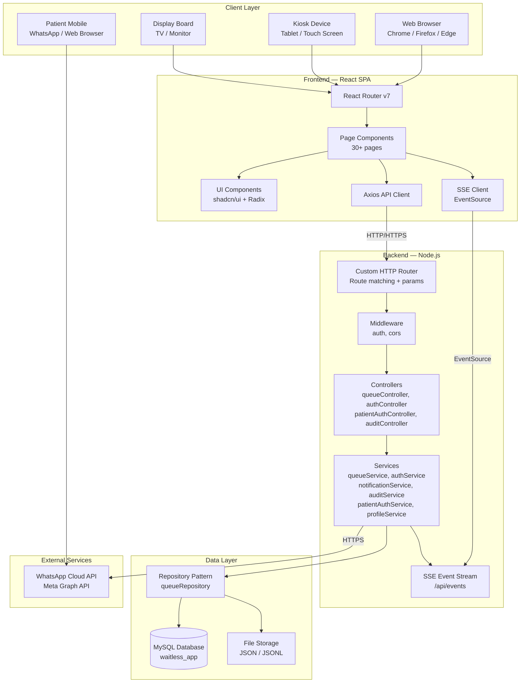

### 3.5.2 Layered Architecture Description

The system follows a strict layered architecture with clear separation of concerns:

| Layer | Responsibility | Key Files |
|-------|---------------|-----------|
| **Presentation Layer** | Renders UI, captures user input, displays real-time updates | `frontend/src/pages/`, `frontend/src/components/` |
| **API/Controller Layer** | Receives HTTP requests, validates input, calls services, formats responses | `backend/src/controllers/`, `backend/src/index.js` |
| **Service/Business Logic Layer** | Implements domain rules, queue algorithms, notification dispatch, authentication | `backend/src/services/` |
| **Repository/Data Access Layer** | Abstracts data persistence, supports MySQL and file-based modes | `backend/src/repositories/` |
| **External Integration Layer** | Communicates with WhatsApp Cloud API | `backend/src/services/whatsAppProvider.js` |

### 3.5.3 Technology Architecture

| Component | Technology | Version |
|-----------|-----------|---------|
| Frontend Framework | React | 19.2.0 |
| Build Tool | Vite | 7.3.1 |
| Routing | React Router DOM | 7.10.1 |
| Styling | Tailwind CSS | 4.2.1 |
| UI Components | Radix UI (shadcn/ui) | Various |
| Charts | Recharts | 2.15.4 |
| HTTP Client | Axios | 1.7.9 |
| Form Validation | Zod + react-hook-form | 3.24.2 / 7.71.2 |
| Icons | Lucide React | 0.575.0 |
| Toast Notifications | Sonner | 2.0.7 |
| QR Code | qrcode | 1.5.4 |
| QR Scanning | html5-qrcode | 2.3.8 |
| Backend Runtime | Node.js | 18+ (ESM) |
| Database Driver | mysql2 | 3.6.0 |
| Password Hashing | bcryptjs | 2.4.3 |
| Environment Config | dotenv | 16.3.1 |
| Real-time Protocol | Server-Sent Events (SSE) | Native |
| Notification Provider | WhatsApp Cloud API (Meta Graph) | v23.0 |

### 3.5.4 Deployment Architecture

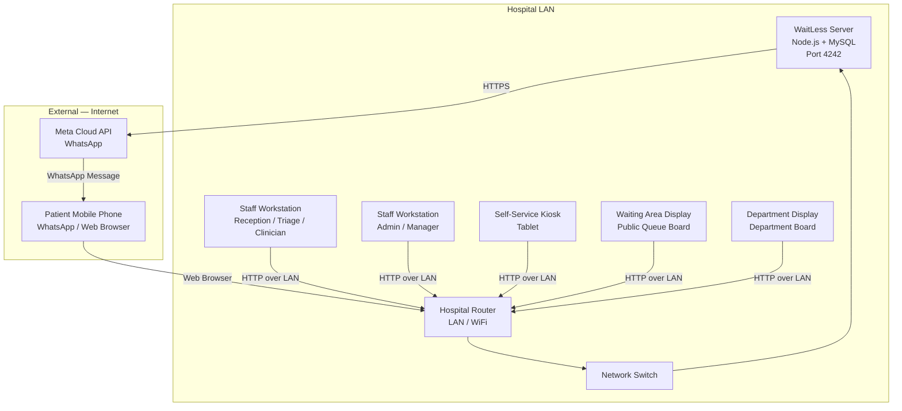

The system is designed for primary deployment on a hospital local area network (LAN). The Node.js server and MySQL database run on a single machine or a small server within the hospital network. Staff workstations, kiosks, and display boards connect to the server over the LAN via standard HTTP. External WhatsApp notifications are sent via HTTPS to the Meta Cloud API, which requires internet connectivity. The system can operate in a reduced capacity (core queue management without notifications) when internet is unavailable.

---

## 3.6 Data Design

### 3.6.1 Entity-Relationship Diagram

```mermaid
erDiagram
    departments ||--o{ tickets : "has"
    departments ||--o{ staff_users : "assigns"
    patient_profiles ||--o{ tickets : "registers"
    tickets ||--o{ notifications : "triggers"
    notifications ||--o{ notification_attempts : "has"
    staff_users ||--o{ audit_events : "performs"
    patient_users ||--o{ patient_profiles : "owns"

    departments {
        VARCHAR name PK
        TIMESTAMP created_at
    }

    patient_profiles {
        CHAR id PK
        VARCHAR patient_number UK
        VARCHAR full_name
        VARCHAR national_id
        DATE dob
        VARCHAR gender
        VARCHAR phone
        VARCHAR address
        VARCHAR patient_category
        VARCHAR next_of_kin_name
        VARCHAR next_of_kin_phone
        DATETIME created_at
        DATETIME updated_at
        DATETIME last_visit_at
    }

    tickets {
        CHAR id PK
        VARCHAR ticket_code UK
        INT sequence_number
        CHAR patient_id FK
        VARCHAR patient_name
        VARCHAR national_id
        DATE dob
        VARCHAR gender
        VARCHAR phone
        VARCHAR address
        VARCHAR patient_category
        VARCHAR next_of_kin_name
        VARCHAR next_of_kin_phone
        BOOLEAN notification_consent
        VARCHAR department FK
        TEXT chief_complaint
        VARCHAR priority
        VARCHAR status
        DATETIME registered_at
        DATETIME triaged_at
        DATETIME called_at
        DATETIME service_started_at
        DATETIME missed_at
        DATETIME recalled_at
        DATETIME transferred_at
        VARCHAR previous_department
        INT recall_count
        DATETIME completed_at
        BOOLEAN whatsapp_enabled
    }

    notifications {
        CHAR id PK
        BIGINT sequence_number UK
        CHAR ticket_id FK
        VARCHAR ticket_code
        VARCHAR patient_name
        VARCHAR department
        VARCHAR priority
        VARCHAR channel
        VARCHAR type
        VARCHAR status
        VARCHAR title
        TEXT message
        VARCHAR recipient
        VARCHAR destination
        VARCHAR provider
        VARCHAR provider_message_id
        DATETIME created_at
        DATETIME sent_at
        DATETIME delivered_at
        DATETIME last_attempt_at
        DATETIME next_retry_at
        VARCHAR error_code
        TEXT error_message
        INT max_attempts
    }

    notification_attempts {
        CHAR notification_id PK
        INT sequence_number PK
        VARCHAR status
        DATETIME attempted_at
        DATETIME completed_at
        VARCHAR provider_message_id
        VARCHAR error_code
        TEXT error_message
    }

    staff_users {
        CHAR id PK
        VARCHAR username UK
        VARCHAR email UK
        VARCHAR password_hash
        VARCHAR full_name
        VARCHAR role
        VARCHAR department
        VARCHAR phone
        VARCHAR employee_id
        TEXT avatar_url
        DATETIME created_at
        DATETIME last_login_at
    }

    patient_users {
        CHAR id PK
        VARCHAR username UK
        VARCHAR email UK
        VARCHAR password_hash
        VARCHAR full_name
        VARCHAR phone
        VARCHAR national_id
        DATE dob
        VARCHAR gender
        DATETIME created_at
        DATETIME last_login_at
    }

    audit_events {
        CHAR id PK
        DATETIME occurred_at
        CHAR actor_id
        VARCHAR actor_name
        VARCHAR actor_role
        VARCHAR actor_department
        VARCHAR action
        VARCHAR entity_type
        VARCHAR entity_id
        VARCHAR entity_label
        VARCHAR outcome
        JSON before_state
        JSON after_state
        JSON metadata
        CHAR previous_hash
        CHAR event_hash UK
    }

    system_counters {
        VARCHAR name PK
        BIGINT value
    }
```

### 3.6.2 Data Dictionary

#### Table: departments

| Column | Type | Constraints | Description |
|--------|------|-------------|-------------|
| name | VARCHAR(80) | PRIMARY KEY | Department name (e.g., "OPD", "Casualty / Triage") |
| created_at | TIMESTAMP(3) | NOT NULL, DEFAULT CURRENT_TIMESTAMP | Record creation timestamp |

#### Table: patient_profiles

| Column | Type | Constraints | Description |
|--------|------|-------------|-------------|
| id | CHAR(36) | PRIMARY KEY | UUID identifier |
| patient_number | VARCHAR(24) | NOT NULL, UNIQUE | Permanent patient number (e.g., "PT-0001") |
| full_name | VARCHAR(160) | NOT NULL | Patient's full name |
| national_id | VARCHAR(80) | NULL | National ID number |
| dob | DATE | NULL | Date of birth |
| gender | VARCHAR(40) | NOT NULL, DEFAULT 'unknown' | Gender (male/female/unknown) |
| phone | VARCHAR(80) | NULL | Phone number for notifications |
| address | VARCHAR(255) | NOT NULL, DEFAULT '' | Residential address |
| patient_category | VARCHAR(80) | NOT NULL, DEFAULT 'walk-in' | Category (walk-in, referred, emergency, etc.) |
| next_of_kin_name | VARCHAR(160) | NOT NULL, DEFAULT '' | Next of kin full name |
| next_of_kin_phone | VARCHAR(80) | NOT NULL, DEFAULT '' | Next of kin phone number |
| created_at | DATETIME(3) | NOT NULL | Profile creation timestamp |
| updated_at | DATETIME(3) | NOT NULL | Last update timestamp |
| last_visit_at | DATETIME(3) | NULL | Last visit timestamp |

**Indexes:** idx_patient_profiles_name (full_name), idx_patient_profiles_national_id (national_id), idx_patient_profiles_phone (phone)

#### Table: tickets

| Column | Type | Constraints | Description |
|--------|------|-------------|-------------|
| id | CHAR(36) | PRIMARY KEY | UUID identifier |
| ticket_code | VARCHAR(20) | NOT NULL, UNIQUE | Queue token (e.g., "OPD-205") |
| sequence_number | INT | NOT NULL | Department-specific sequence |
| patient_id | CHAR(36) | NULL, FK → patient_profiles(id) | Linked patient profile |
| patient_name | VARCHAR(160) | NOT NULL | Patient name (denormalised) |
| national_id | VARCHAR(80) | NOT NULL, DEFAULT '' | National ID (denormalised) |
| dob | DATE | NULL | Date of birth (denormalised) |
| gender | VARCHAR(40) | NOT NULL, DEFAULT 'unknown' | Gender (denormalised) |
| phone | VARCHAR(80) | NOT NULL, DEFAULT '' | Phone (denormalised) |
| address | VARCHAR(255) | NOT NULL, DEFAULT '' | Address (denormalised) |
| patient_category | VARCHAR(80) | NOT NULL, DEFAULT 'walk-in' | Category (denormalised) |
| next_of_kin_name | VARCHAR(160) | NOT NULL, DEFAULT '' | Next of kin name (denormalised) |
| next_of_kin_phone | VARCHAR(80) | NOT NULL, DEFAULT '' | Next of kin phone (denormalised) |
| notification_consent | BOOLEAN | NOT NULL, DEFAULT FALSE | WhatsApp notification opt-in |
| department | VARCHAR(80) | NOT NULL, FK → departments(name) | Current department |
| chief_complaint | TEXT | NULL | Patient's chief complaint |
| priority | VARCHAR(20) | NOT NULL | Priority level (red/yellow/green/black) |
| status | VARCHAR(30) | NOT NULL | Ticket status (waiting/called/in-service/missed/completed) |
| registered_at | DATETIME(3) | NOT NULL | Registration timestamp |
| triaged_at | DATETIME(3) | NULL | Triage assessment timestamp |
| called_at | DATETIME(3) | NULL | When patient was called |
| service_started_at | DATETIME(3) | NULL | When service began |
| missed_at | DATETIME(3) | NULL | When marked missed |
| recalled_at | DATETIME(3) | NULL | When recalled |
| transferred_at | DATETIME(3) | NULL | When transferred |
| previous_department | VARCHAR(80) | NOT NULL, DEFAULT '' | Previous department (for transfers) |
| recall_count | INT | NOT NULL, DEFAULT 0 | Number of recalls |
| completed_at | DATETIME(3) | NULL | Service completion timestamp |
| whatsapp_enabled | BOOLEAN | NOT NULL, DEFAULT FALSE | WhatsApp enabled flag |

**Indexes:** idx_tickets_department_status (department, status), idx_tickets_priority_status (priority, status), idx_tickets_registered_at (registered_at), idx_tickets_patient_id (patient_id)

#### Table: notifications

| Column | Type | Constraints | Description |
|--------|------|-------------|-------------|
| id | CHAR(36) | PRIMARY KEY | UUID identifier |
| sequence_number | BIGINT | NOT NULL, UNIQUE | Monotonic sequence |
| ticket_id | CHAR(36) | NOT NULL, FK → tickets(id) | Related ticket |
| ticket_code | VARCHAR(20) | NOT NULL | Ticket code (denormalised) |
| patient_name | VARCHAR(160) | NOT NULL | Patient name (denormalised) |
| department | VARCHAR(80) | NOT NULL | Department (denormalised) |
| priority | VARCHAR(20) | NOT NULL | Priority (denormalised) |
| channel | VARCHAR(40) | NOT NULL | Notification channel (whatsapp, display-board) |
| type | VARCHAR(80) | NOT NULL | Notification type (queue.registered, queue.called, etc.) |
| status | VARCHAR(40) | NOT NULL | Delivery status (pending, sent, delivered, failed) |
| title | VARCHAR(255) | NOT NULL | Notification title |
| message | TEXT | NOT NULL | Message body |
| recipient | VARCHAR(160) | NOT NULL | Recipient phone number |
| destination | VARCHAR(160) | NULL | Destination department |
| provider | VARCHAR(80) | NULL | Provider name (mock, meta-cloud) |
| provider_message_id | VARCHAR(160) | NULL | Provider's message ID |
| created_at | DATETIME(3) | NOT NULL | Creation timestamp |
| sent_at | DATETIME(3) | NULL | When sent to provider |
| delivered_at | DATETIME(3) | NULL | When delivered |
| last_attempt_at | DATETIME(3) | NULL | Last attempt timestamp |
| next_retry_at | DATETIME(3) | NULL | Next scheduled retry |
| error_code | VARCHAR(80) | NULL | Error code from provider |
| error_message | TEXT | NULL | Error message from provider |
| max_attempts | INT | NOT NULL, DEFAULT 1 | Maximum retry attempts |

**Indexes:** idx_notifications_ticket_id, idx_notifications_status, idx_notifications_channel, idx_notifications_provider_message_id, idx_notifications_created_at

#### Table: notification_attempts

| Column | Type | Constraints | Description |
|--------|------|-------------|-------------|
| notification_id | CHAR(36) | PK, FK → notifications(id) | Related notification |
| sequence_number | INT | PK | Attempt sequence |
| status | VARCHAR(40) | NOT NULL | Attempt status |
| attempted_at | DATETIME(3) | NOT NULL | Attempt timestamp |
| completed_at | DATETIME(3) | NULL | Completion timestamp |
| provider_message_id | VARCHAR(160) | NULL | Provider message ID |
| error_code | VARCHAR(80) | NULL | Error code |
| error_message | TEXT | NULL | Error message |

#### Table: staff_users

| Column | Type | Constraints | Description |
|--------|------|-------------|-------------|
| id | CHAR(36) | PRIMARY KEY | UUID identifier |
| username | VARCHAR(32) | NOT NULL, UNIQUE | Login username |
| email | VARCHAR(120) | NOT NULL, UNIQUE | Email address |
| password_hash | VARCHAR(255) | NOT NULL | bcrypt password hash |
| full_name | VARCHAR(160) | NOT NULL | Staff member's full name |
| role | VARCHAR(40) | NOT NULL, DEFAULT 'reception' | Role (admin, reception, triage, clinician) |
| department | VARCHAR(80) | NOT NULL, DEFAULT '' | Assigned department |
| phone | VARCHAR(80) | NULL | Phone number |
| employee_id | VARCHAR(80) | NULL | Employee ID |
| avatar_url | TEXT | NULL | Avatar image URL |
| created_at | DATETIME(3) | NOT NULL, DEFAULT CURRENT_TIMESTAMP | Creation timestamp |
| last_login_at | DATETIME(3) | NULL | Last login timestamp |

#### Table: patient_users

| Column | Type | Constraints | Description |
|--------|------|-------------|-------------|
| id | CHAR(36) | PRIMARY KEY | UUID identifier |
| username | VARCHAR(32) | NOT NULL, UNIQUE | Login username |
| email | VARCHAR(120) | NOT NULL, UNIQUE | Email address |
| password_hash | VARCHAR(255) | NOT NULL | bcrypt password hash |
| full_name | VARCHAR(160) | NOT NULL | Patient's full name |
| phone | VARCHAR(80) | NOT NULL | Phone number |
| national_id | VARCHAR(80) | NULL | National ID |
| dob | DATE | NULL | Date of birth |
| gender | VARCHAR(40) | NOT NULL, DEFAULT 'unknown' | Gender |
| created_at | DATETIME(3) | NOT NULL, DEFAULT CURRENT_TIMESTAMP | Creation timestamp |
| last_login_at | DATETIME(3) | NULL | Last login timestamp |

#### Table: audit_events

| Column | Type | Constraints | Description |
|--------|------|-------------|-------------|
| id | CHAR(36) | PRIMARY KEY | UUID identifier |
| occurred_at | DATETIME(3) | NOT NULL | When the event occurred |
| actor_id | CHAR(36) | NULL | Staff user ID who performed the action |
| actor_name | VARCHAR(160) | NULL | Staff name (denormalised) |
| actor_role | VARCHAR(40) | NULL | Staff role (denormalised) |
| actor_department | VARCHAR(80) | NULL | Staff department (denormalised) |
| action | VARCHAR(100) | NOT NULL | Action type (e.g., "ticket.create", "auth.login") |
| entity_type | VARCHAR(80) | NOT NULL | Entity type (ticket, staff, notification) |
| entity_id | VARCHAR(80) | NULL | Entity ID |
| entity_label | VARCHAR(160) | NULL | Entity label (e.g., ticket code) |
| outcome | VARCHAR(40) | NOT NULL, DEFAULT 'success' | Outcome (success, failure) |
| before_state | JSON | NULL | State before the action |
| after_state | JSON | NULL | State after the action |
| metadata | JSON | NULL | Additional metadata |
| previous_hash | CHAR(64) | NULL | Hash of the previous audit event |
| event_hash | CHAR(64) | NOT NULL, UNIQUE | SHA-256 hash of this event |

**Indexes:** idx_audit_events_occurred_at, idx_audit_events_actor_id, idx_audit_events_action, idx_audit_events_entity

#### Table: system_counters

| Column | Type | Constraints | Description |
|--------|------|-------------|-------------|
| name | VARCHAR(80) | PRIMARY KEY | Counter name (e.g., "OPD", "TRI", "PHA") |
| value | BIGINT | NOT NULL | Current counter value |

### 3.6.3 Data Flow Diagrams

#### DFD Level 0 — Context Diagram

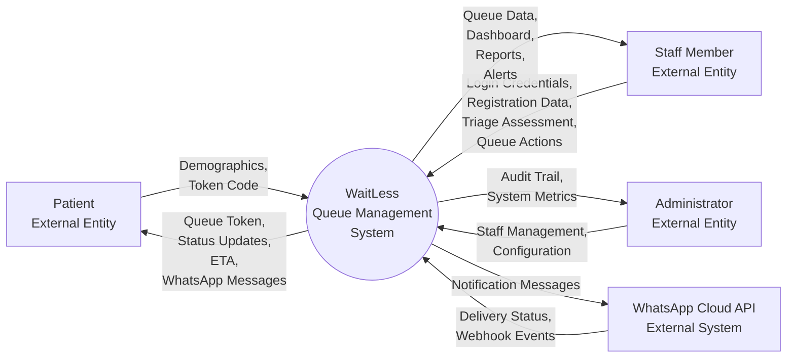

#### DFD Level 1 — Major Processes

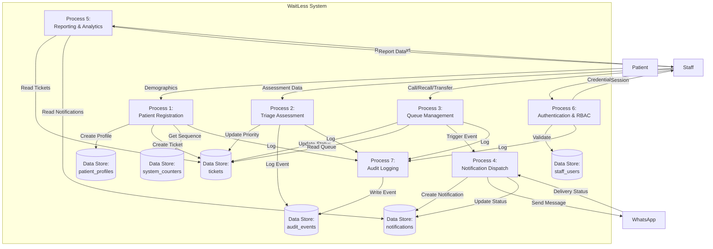

#### DFD Level 2 — Patient Registration Detail

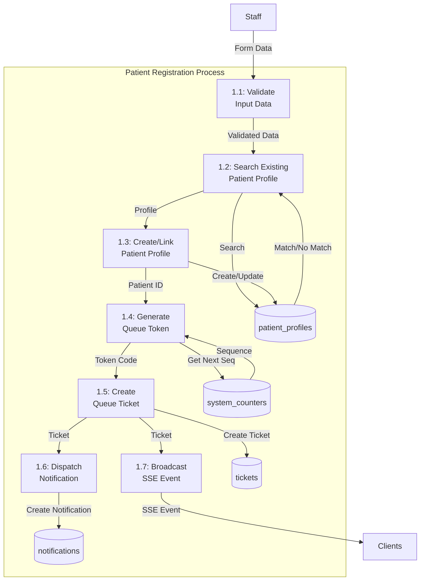

---

## 3.7 Process Design

### 3.7.1 Sequence Diagram: Patient Registration

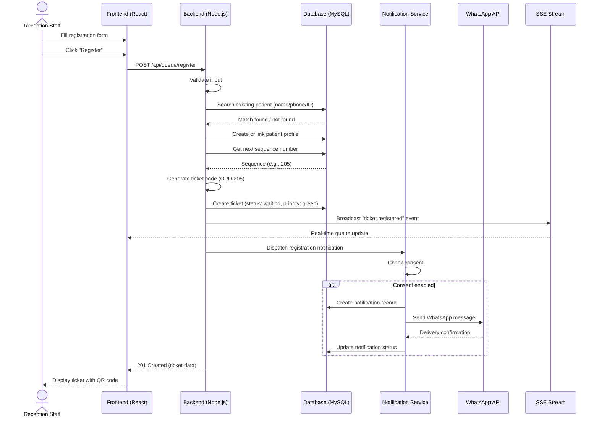

### 3.7.2 Sequence Diagram: Triage Assessment

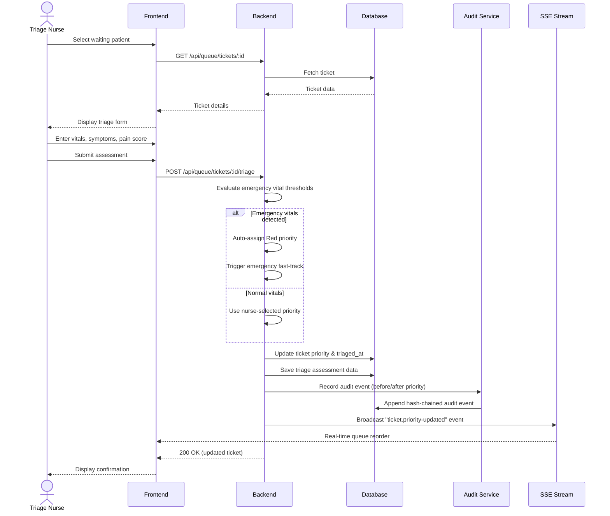

### 3.7.3 Sequence Diagram: Call Next Patient

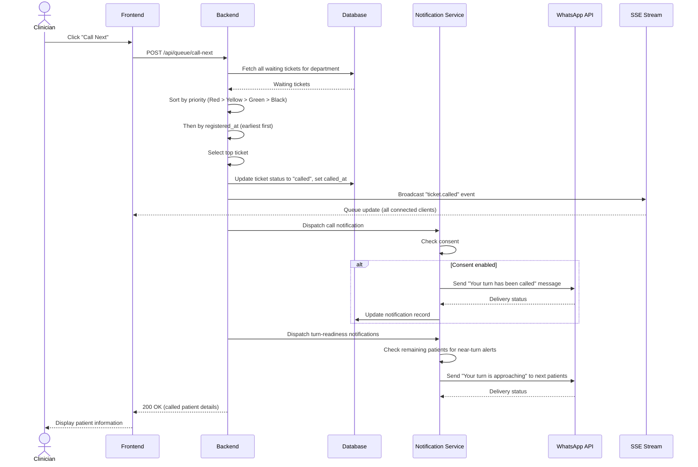

### 3.7.4 Sequence Diagram: Notification Dispatch with Retry

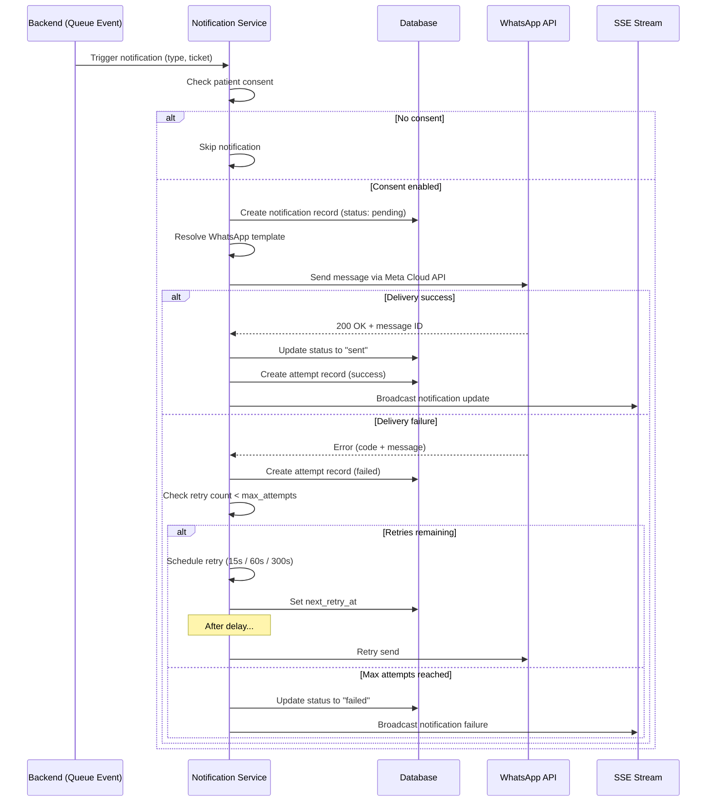

### 3.7.5 Activity Diagram: Patient Journey

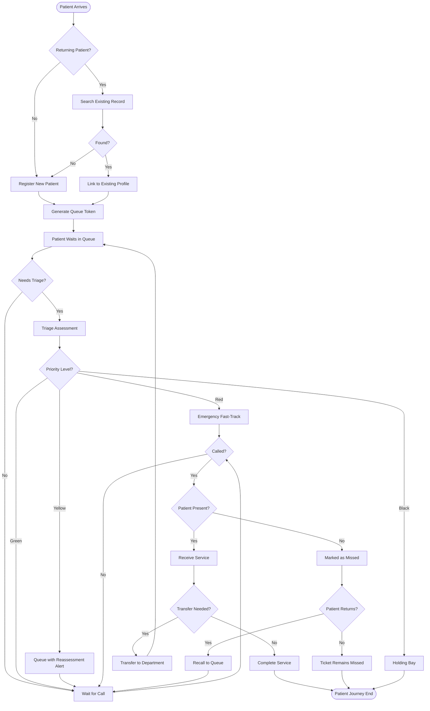

### 3.7.6 Activity Diagram: Triage Workflow

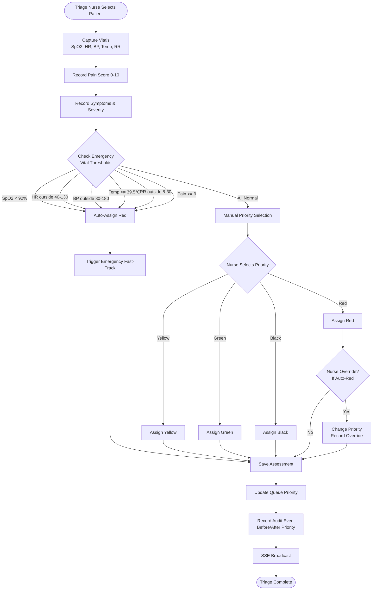

### 3.7.7 Activity Diagram: Notification Retry Lifecycle

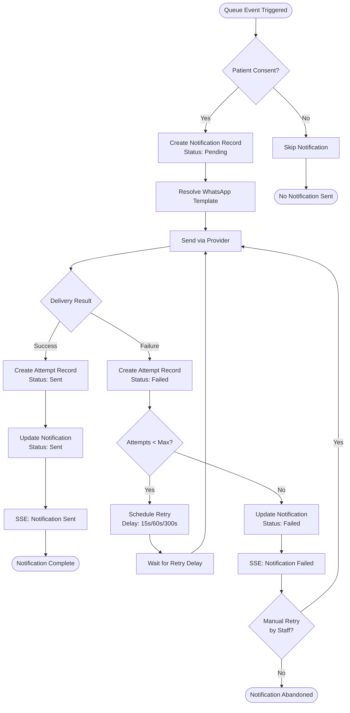

---

## 3.8 User Interface Design

### 3.8.1 UI Design Principles

The WaitLess user interface is designed with the following principles:

1. **Medical Professional Aesthetic** — A dark teal (#0F766E) and navy colour scheme conveys clinical professionalism while reducing eye strain in hospital environments with varied lighting conditions.

2. **Glassmorphism Design** — Semi-transparent "glass" cards with backdrop blur create depth and visual hierarchy without overwhelming the user.

3. **Responsive Design** — The interface adapts to desktop monitors, tablets, and mobile phones using Tailwind CSS responsive breakpoints.

4. **Real-Time Feedback** — All queue updates are reflected instantly via Server-Sent Events, with visual indicators for connection status.

5. **Accessibility** — High contrast text, keyboard navigation, ARIA labels, and semantic HTML ensure the system is usable by staff with varying abilities.

6. **Role-Based Navigation** — Staff see only the navigation items and pages relevant to their role, reducing cognitive load.

7. **Privacy by Design** — Public displays show only token numbers, never patient names. Patient-facing pages minimise exposed personal information.

### 3.8.2 Colour Palette

| Purpose | Colour | Hex |
|---------|--------|-----|
| Primary (Medical Teal) | Teal | #0F766E |
| Secondary (Hospital Blue) | Blue | #2563EB |
| Priority Red | Red | #DC2626 |
| Priority Yellow | Amber | #F59E0B |
| Priority Green | Emerald | #10B981 |
| Priority Black | Dark Grey | #1F2937 |
| Background (Dark) | Navy/Black | #0A0F1A |
| Surface (Glass) | Semi-transparent | rgba(255,255,255,0.05) |
| Text Primary | White | #F8FAFC |
| Text Muted | Slate | #94A3B8 |

### 3.8.3 Typography

| Element | Font | Size | Weight |
|---------|------|------|--------|
| Headings | System sans-serif | 1.5rem – 2.25rem | 700 |
| Body text | System sans-serif | 0.875rem – 1rem | 400 |
| Labels | System sans-serif | 0.75rem | 500 |
| Token numbers | Monospace | 2rem – 4rem | 700 |
| Captions | System sans-serif | 0.75rem | 400 |

### 3.8.4 Navigation Structure

```mermaid
graph TD
    Root[/ WaitLess]

    Root --> Public[Public Pages]
    Root --> Patient[Patient Portal]
    Root --> Staff[Staff Workspace /admin]

    Public --> Home[/ Home /]
    Public --> Queue[/ Queue Board /]
    Public --> DeptBoard[/ Department Board /]
    Public --> Track[/ Track Ticket /]
    Public --> SelfReg[/ Self-Register /]
    Public --> Kiosk[/ Kiosk Check-in /]

    Patient --> PatLogin[/ Patient Login /]
    Patient --> PatReg[/ Patient Register /]
    Patient --> PatDash[/ Patient Dashboard /]
    Patient --> PatProfile[/ Patient Profile /]
    Patient --> PatSettings[/ Patient Settings /]

    Staff --> StaffLogin[/ Staff Login /]
    Staff --> Dash[/ Dashboard - triage/clinician /]
    Staff --> Reg[/ Register - reception /]
    Staff --> Triage[/ Triage - triage /]
    Staff --> StaffQueue[/ Queue Board /]
    Staff --> Depts[/ Departments /]
    Staff --> Appts[/ Appointments /]
    Staff --> Pharmacy[/ Pharmacy - clinician/triage /]
    Staff --> Lab[/ Laboratory - clinician/triage /]
    Staff --> Reports[/ Reports /]
    Staff --> Analytics[/ Analytics /]
    Staff --> Notifs[/ Notifications /]
    Staff --> StaffMgmt[/ Staff Management - admin /]
    Staff --> Audit[/ Audit Trail - admin /]
    Staff --> Settings[/ Settings /]
    Staff --> Profile[/ My Profile /]
```

### 3.8.5 Key Page Descriptions

#### Landing Page (/)
- Hero section with WaitLess logo, tagline, and call-to-action buttons
- Live statistics display (patients served, current waiting, departments active)
- Feature highlights with icons
- Footer with hospital branding

#### Patient Registration (/admin/register)
- Multi-section form: demographics, next of kin, chief complaint, department selection
- Real-time form validation with inline error messages
- QR code scanner for returning patient lookup
- Patient category selector with visual icons
- Notification consent toggle
- On submit: ticket display with QR code, print button, and WhatsApp share

#### Triage Assessment (/admin/triage)
- Patient selector from waiting queue (sorted by priority)
- Vitals input form with range indicators and colour-coded warnings
- Pain score slider (0–10) with visual scale
- Symptoms and severity text areas
- Emergency vital threshold warnings (real-time as values are entered)
- Priority selection (auto-suggested based on vitals, manually overridable)
- Assessment history for previously triaged patients

#### Public Queue Board (/queue)
- Large-format display optimised for TV/monitor screens
- Three columns: "Now Serving", "Waiting", "Missed"
- Token numbers displayed in large monospace font
- Priority colour coding (red, yellow, green borders)
- Real-time updates via SSE (no page refresh)
- Department filter selector
- Animated transitions when tickets move between columns

#### Department Display Board (/department-board)
- Department-specific view (filtered by URL parameter)
- Shows only tickets for the selected department
- Larger token number display for waiting area visibility
- Real-time SSE updates
- Auto-refresh on connection loss

#### Staff Dashboard (/admin/dashboard)
- Live metrics cards: waiting count, in-service count, missed count, avg wait time
- Department-scoped queue table with sortable columns
- Patient action buttons: call next, mark missed, recall, transfer
- Operational alerts panel: reassessment alerts, notification failures, critical metrics
- Notification analytics with charts (delivery rate, retry trends)
- Real-time auto-refresh

#### Patient Tracking (/track)
- Token code input field with auto-lookup
- Progress indicator showing queue position
- Estimated wait time display
- Patients ahead count
- Department directions and current status
- Notification history timeline
- Real-time updates via SSE

#### Reports (/admin/reports)
- Tabbed interface: Overview, Average Wait Time, Department Performance, No-Show, Triage, WhatsApp Status
- Date range picker (from/to)
- Summary metric cards per report type
- Department breakdown tables
- Per-ticket notification correlation (no-show report)
- WhatsApp configuration checklist (status report)

#### Audit Trail (/admin/audit)
- Chronological list of audit events
- Filterable by action type, actor, date range
- Before/after state comparison view
- Hash chain verification indicator
- Actor details: name, role, department
- Redacted sensitive fields

---

## 3.9 Security Design

### 3.9.1 Authentication Model

The system implements two separate authentication flows:

**Staff Authentication:**
- Staff users log in with username/email and password
- Passwords are hashed using bcrypt with a cost factor of 12
- On successful login, a bearer token session is created (in-memory Map)
- Session token is included in the Authorization header for all API requests
- Sessions expire after 8 hours (configurable via `AUTH_SESSION_TTL_MS`)
- Password policy enforced: minimum 8 characters, at least 3 character groups (uppercase, lowercase, digits, special), common password rejection

**Patient Authentication:**
- Patient users register and log in with username/email and password
- Passwords are hashed using bcrypt
- Separate session management from staff authentication
- Patient sessions stored in localStorage with expiry tracking

### 3.9.2 Role-Based Access Control Matrix

| Resource/Action | Admin | Reception | Triage | Clinician | Patient | Anonymous |
|----------------|-------|-----------|--------|-----------|---------|-----------|
| View public queue board | ✓ | ✓ | ✓ | ✓ | ✓ | ✓ |
| Track ticket | ✓ | ✓ | ✓ | ✓ | ✓ | ✓ |
| Self-register / kiosk | ✓ | ✓ | ✓ | ✓ | ✓ | ✓ |
| Register patient | ✓ | ✓ | ✗ | ✗ | ✗ | ✗ |
| Triage assessment | ✓ | ✗ | ✓ | ✗ | ✗ | ✗ |
| Call next patient | ✓ | ✗ | ✓ | ✓ | ✗ | ✗ |
| Mark missed/recall | ✓ | ✗ | ✓ | ✓ | ✗ | ✗ |
| Transfer patient | ✓ | ✓ | ✓ | ✓ | ✗ | ✗ |
| View dashboard | ✓ | ✗ | ✓ | ✓ | ✗ | ✗ |
| View reports | ✓ | ✓ | ✓ | ✓ | ✗ | ✗ |
| Manage staff | ✓ | ✗ | ✗ | ✗ | ✗ | ✗ |
| View audit trail | ✓ | ✗ | ✗ | ✗ | ✗ | ✗ |
| Configure settings | ✓ | ✓ | ✓ | ✓ | ✗ | ✗ |
| Prescribe medication | ✓ | ✗ | ✓ | ✓ | ✗ | ✗ |
| Order lab tests | ✓ | ✗ | ✓ | ✓ | ✗ | ✗ |
| View patient portal | ✗ | ✗ | ✗ | ✗ | ✓ | ✗ |

### 3.9.3 Audit Trail Design

The audit trail provides a tamper-evident record of all system actions:

1. **Append-Only Storage** — Audit events are written to the `audit_events` table (MySQL) or `audit-events.jsonl` file. No update or delete operations are supported.

2. **SHA-256 Hash Chaining** — Each audit event includes:
   - `previous_hash`: The `event_hash` of the preceding event
   - `event_hash`: SHA-256 hash of the event's content + `previous_hash`
   
   This creates a cryptographic chain where modifying any event invalidates all subsequent hashes.

3. **Sensitive Data Redaction** — Passwords, session tokens, and other sensitive fields are redacted in the `before_state` and `after_state` JSON before hashing.

4. **Actor Attribution** — Every event records the actor's ID, name, role, and department, providing full accountability.

5. **Tracked Actions** — Login, staff creation, profile updates, ticket creation, triage assessment, priority changes, status updates, recalls, transfers, prescription and test order events, arrival confirmation, and notification retries.

### 3.9.4 Privacy Measures

| Measure | Implementation |
|---------|---------------|
| Anonymous public displays | Queue board and department board show only token numbers, never patient names |
| Notification consent | Patients explicitly opt in to WhatsApp notifications during registration |
| Patient tracking privacy | Tracking page requires only a token code; no authentication needed, but no personal data is displayed |
| Audit redaction | Sensitive fields are redacted before storage in audit events |
| Department scoping | Non-admin staff see only their department's data in dashboards, tickets, and notifications |

---

## 3.10 Summary

This chapter has presented a comprehensive system analysis and design for the WaitLess Digital Queue Management System. The requirements analysis identified 83 functional requirements across 21 modules, supplemented by 15 non-functional requirements and stakeholder-specific user requirements. Use case diagrams and detailed descriptions model the key interactions between actors and the system. The system architecture was defined as a layered client-server design with React frontend, Node.js backend, dual-mode data storage, and WhatsApp Cloud API integration. The data design section provided a complete entity-relationship diagram, data dictionary, and data flow diagrams. Process design was illustrated through sequence and activity diagrams for critical system flows. The user interface design established the visual language, navigation structure, and page descriptions. Finally, the security design detailed the authentication model, role-based access control, audit trail, and privacy measures.

The next chapter, Chapter 4: Implementation, details how this design was realised in code, including the technology stack, module implementations, and deployment configuration.
