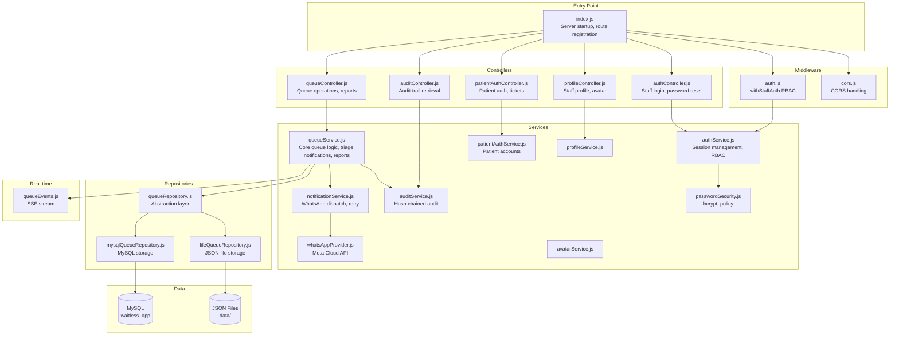

# Chapter 4: Implementation

## 4.1 Introduction

This chapter details the implementation of the WaitLess Digital Queue Management System, covering the technology stack, system structure, backend and frontend implementation, database design, external integrations, and deployment configuration. The implementation follows the system design presented in Chapter 3, translating the architectural blueprint into a working, deployable application.

The system was built as a final year project for Chinhoyi Provincial Hospital, Zimbabwe, with development following an iterative approach: core queue functionality was established first, followed by triage assessment, notifications, reporting, patient self-service, and department-specific features.

---

## 4.2 Technology Stack

### 4.2.1 Frontend Technologies

| Technology | Version | Purpose |
|-----------|---------|---------|
| React | 19.2.0 | UI framework with hooks, concurrent rendering |
| Vite | 7.3.1 | Build tool and development server |
| React Router DOM | 7.10.1 | Client-side routing with nested routes |
| Tailwind CSS | 4.2.1 | Utility-first CSS framework |
| Radix UI | Various | Accessible, unstyled headless UI primitives |
| shadcn/ui | — | Component library built on Radix UI |
| Recharts | 2.15.4 | Charts and data visualisation |
| Axios | 1.7.9 | HTTP client with interceptors |
| Zod | 3.24.2 | Schema validation |
| react-hook-form | 7.71.2 | Performant form management |
| Lucide React | 0.575.0 | Icon library |
| Sonner | 2.0.7 | Toast notifications |
| qrcode | 1.5.4 | QR code generation |
| html5-qrcode | 2.3.8 | Camera-based QR code scanning |
| Lottie React | 2.4.1 | Animations |

### 4.2.2 Backend Technologies

| Technology | Version | Purpose |
|-----------|---------|---------|
| Node.js | 18+ (ESM) | JavaScript runtime |
| Custom HTTP Router | — | Route matching, parameter extraction, request handling |
| MySQL (mysql2) | 3.6.0 | Primary database driver |
| File-based JSON | — | Fallback storage mode |
| bcryptjs | 2.4.3 | Password hashing |
| dotenv | 16.3.1 | Environment variable management |
| Server-Sent Events | Native | Real-time queue updates |

### 4.2.3 Development Tools

| Tool | Purpose |
|------|---------|
| ESLint | Code linting and style enforcement |
| Prettier | Code formatting |
| Nodemon | Auto-restart backend during development |
| Git | Version control |
| Node.js native test runner | Backend unit testing |

### 4.2.4 Architecture Decision Records

**ADR-01: Custom HTTP Router instead of Express**

The backend uses a lightweight custom HTTP router built on Node.js's native `http` module rather than the Express framework. This decision was made to:
- Minimise dependencies and reduce the attack surface
- Maintain full control over request parsing, route matching, and error handling
- Reduce bundle size and startup time
- Provide a learning opportunity in understanding HTTP server fundamentals

The custom router (`backend/src/utils/router.js`) supports:
- HTTP method-based route registration
- Path parameter extraction (e.g., `/api/tickets/:id`)
- Query string parsing via `URLSearchParams`
- JSON body parsing with size limits (3 MB max)
- Automatic trailing slash normalisation

**ADR-02: Server-Sent Events instead of WebSocket**

Real-time updates are delivered via Server-Sent Events (SSE) rather than WebSocket. Rationale:
- SSE is simpler to implement and requires no additional libraries
- Unidirectional communication (server-to-client) is sufficient for queue updates
- SSE works over standard HTTP, simplifying proxy and firewall configuration
- Built-in reconnection with configurable retry interval
- Lower overhead for the hospital LAN environment

The SSE implementation (`backend/src/sockets/queueEvents.js`) provides:
- Persistent connections via `text/event-stream` content type
- Heartbeat pings every 25 seconds to keep connections alive
- Configurable retry interval (3 seconds) for client reconnection
- Event broadcasting for all queue state changes

**ADR-03: Dual-Mode Storage (MySQL + File)**

The system supports both MySQL and file-based JSON storage, controlled by the `DB_PROVIDER` environment variable. This provides:
- Production deployment with MySQL for data integrity and concurrent access
- Development and testing with file-based storage for zero-configuration setup
- Deployment flexibility for hospitals with varying infrastructure

The repository pattern (`backend/src/repositories/queueRepository.js`) abstracts the storage mode, exposing a unified interface that both implementations satisfy.

---

## 4.3 System Structure

### 4.3.1 Project Directory Structure

```
WAITLESS/
├── backend/
│   ├── package.json
│   ├── .env
│   ├── data/                          # File-based storage (when DB_PROVIDER=file)
│   │   ├── queue-state.json
│   │   ├── audit-events.jsonl
│   │   └── staff-users.json
│   ├── test/                          # Backend unit tests
│   │   ├── audit-service.test.js
│   │   ├── returning-patient.test.js
│   │   └── staff-auth-security.test.js
│   └── src/
│       ├── index.js                   # Server entry, route registration, startup
│       ├── config/
│       │   └── env.js                 # Environment variable parsing
│       ├── controllers/
│       │   ├── auditController.js
│       │   ├── authController.js
│       │   ├── patientAuthController.js
│       │   ├── profileController.js
│       │   └── queueController.js
│       ├── services/
│       │   ├── auditService.js        # Hash-chained audit trail
│       │   ├── authService.js         # Staff authentication & RBAC
│       │   ├── avatarService.js       # Avatar image handling
│       │   ├── filePatientStore.js    # File-based patient storage
│       │   ├── fileStaffStore.js      # File-based staff storage
│       │   ├── notificationService.js # WhatsApp notification dispatch & retry
│       │   ├── patientAuthService.js  # Patient authentication
│       │   ├── passwordSecurity.js    # Password policy & hashing
│       │   ├── profileService.js      # Staff profile management
│       │   ├── queueService.js        # Core queue business logic (2234 lines)
│       │   ├── sessionService.js      # Session token management
│       │   └── whatsAppProvider.js    # WhatsApp Cloud API provider
│       ├── repositories/
│       │   ├── queueRepository.js     # Repository abstraction layer
│       │   ├── fileQueueRepository.js # File-based implementation
│       │   └── mysqlQueueRepository.js# MySQL implementation
│       ├── middleware/
│       │   ├── auth.js                # Staff authentication middleware
│       │   └── cors.js                # CORS handling
│       ├── modules/
│       │   └── queue/
│       │       └── queue.constants.js # Domain constants & seed data
│       ├── db/
│       │   ├── db.js                  # MySQL connection pool
│       │   ├── initDb.js              # Database initialisation
│       │   ├── schema.sql             # DDL for all tables
│       │   ├── seedAdmin.js           # Admin user seeding
│       │   ├── waitless_db.sql        # Full database export
│       │   └── waitless_tables.sql    # Table definitions
│       ├── sockets/
│       │   └── queueEvents.js         # SSE event stream server
│       └── utils/
│           ├── http.js                # HTTP utilities (errors, body parsing, JSON)
│           └── router.js              # Custom HTTP router
├── frontend/
│   ├── package.json
│   ├── vite.config.js
│   ├── index.html
│   └── src/
│       ├── main.jsx                   # React entry point
│       ├── App.jsx                    # Route definitions
│       ├── App.css
│       ├── index.css                  # Tailwind CSS imports
│       ├── styles.css                 # Global styles
│       ├── assets/                    # Images (BACKG.png, logos)
│       ├── auth/                      # Authentication context
│       │   ├── AuthContext.jsx
│       │   ├── AuthProvider.jsx
│       │   └── PatientAuthProvider.jsx
│       ├── components/                # Reusable UI components
│       │   ├── ui/                    # shadcn/ui components (40+ files)
│       │   ├── dashboard/
│       │   ├── AuthShell.jsx
│       │   ├── PatientAuthShell.jsx
│       │   ├── ProtectedRoute.jsx
│       │   ├── WaitLessLogo.jsx
│       │   └── ...
│       ├── context/
│       │   └── LiveRefreshContext.jsx # Global refresh trigger
│       ├── hooks/
│       │   ├── useApiResource.jsx     # Data fetching hook
│       │   └── use-mobile.jsx
│       ├── layouts/
│       │   ├── AppLayout.jsx          # Main layout (header, footer, routing)
│       │   ├── DashboardLayout.jsx
│       │   └── PatientPortalLayout.jsx
│       ├── pages/                     # Page components (30+ files)
│       │   ├── index.jsx              # Landing page
│       │   ├── register.jsx           # Staff patient registration
│       │   ├── triage.jsx             # Triage assessment
│       │   ├── queue.jsx              # Public queue board
│       │   ├── department-board.jsx   # Department-specific board
│       │   ├── track.jsx              # Patient tracking
│       │   ├── dashboard.jsx          # Staff dashboard
│       │   ├── staff-modules.jsx      # Staff sub-pages (reports, analytics, etc.)
│       │   ├── patient-dashboard.jsx  # Patient portal dashboard
│       │   ├── patient-login.jsx
│       │   ├── patient-register.jsx
│       │   ├── kiosk.jsx              # Self-service kiosk
│       │   ├── self-register.jsx      # Online self-registration
│       │   └── ...
│       ├── services/                  # API and data services
│       │   ├── api.js                 # Axios client configuration
│       │   ├── authApi.js
│       │   ├── authSession.js
│       │   ├── patientAuthApi.js
│       │   ├── patientAuthSession.js
│       │   ├── queueApi.js            # Queue API functions
│       │   ├── queueMeta.js           # Frontend metadata constants
│       │   ├── queueTicketHandoff.js  # Ticket handoff utilities
│       │   └── staffProfilePrefs.js
│       ├── sockets/
│       │   └── QueueRealtimeProvider.jsx  # SSE client
│       ├── store/
│       └── utils/
└── docs/
    └── world-class-system-roadmap.md
```

### 4.3.2 Backend Module Map



### 4.3.3 Frontend Component Hierarchy

```mermaid
graph TB
    subgraph "Root"
        Main[main.jsx]
        App[App.jsx<br/>Route definitions]
    end

    subgraph "Layouts"
        AppLayout[AppLayout.jsx<br/>Header, Footer, routing]
        PatPortalLayout[PatientPortalLayout.jsx<br/>Patient sidebar, topbar]
        DashLayout[DashboardLayout.jsx]
    end

    subgraph "Context Providers"
        AuthProvider[AuthProvider.jsx<br/>Staff auth state]
        PatAuthProvider[PatientAuthProvider.jsx<br/>Patient auth state]
        LiveRefresh[LiveRefreshContext.jsx<br/>Global refresh trigger]
        RealtimeProvider[QueueRealtimeProvider.jsx<br/>SSE client]
    end

    subgraph "Public Pages"
        Home[index.jsx<br/>Landing page]
        Queue[queue.jsx<br/>Public queue board]
        DeptBoard[department-board.jsx<br/>Department board]
        Track[track.jsx<br/>Ticket tracking]
        SelfReg[self-register.jsx]
        Kiosk[kiosk.jsx]
    end

    subgraph "Staff Pages"
        Dashboard[dashboard.jsx<br/>Live staff dashboard]
        Register[register.jsx<br/>Patient registration]
        Triage[triage.jsx<br/>Triage assessment]
        StaffModules[staff-modules.jsx<br/>Reports, Analytics, Pharmacy,<br/>Lab, Notifications, Departments]
        AuditTrail[audit-trail.jsx]
        Profile[profile.jsx]
        Settings[settings.jsx]
    end

    subgraph "Patient Pages"
        PatLogin[patient-login.jsx]
        PatRegister[patient-register.jsx]
        PatDashboard[patient-dashboard.jsx]
        PatProfile[patient-profile.jsx]
        PatSettings[patient-settings.jsx]
    end

    subgraph "UI Components"
        UI[shadcn/ui<br/>40+ components<br/>Button, Card, Dialog,<br/>Table, Tabs, Select, etc.]
        Custom[Custom Components<br/>SystemLoader, RouteLoadingBar,<br/>HeroSlider, ProtectedRoute]
    end

    Main --> App
    App --> AppLayout
    AppLayout --> AuthProvider
    AppLayout --> PatAuthProvider
    AppLayout --> LiveRefresh
    AppLayout --> RealtimeProvider

    AppLayout --> Home
    AppLayout --> Queue
    AppLayout --> Track
    AppLayout --> PatPortalLayout
    PatPortalLayout --> PatDashboard
    PatPortalLayout --> PatProfile
    PatPortalLayout --> PatSettings

    AppLayout --> Dashboard
    AppLayout --> Register
    AppLayout --> Triage
    AppLayout --> StaffModules
    AppLayout --> AuditTrail

    Dashboard --> UI
    Register --> UI
    Triage --> UI
    StaffModules --> UI
```



---

## 4.4 Backend Implementation

### 4.4.1 Custom HTTP Router

The custom HTTP router is the backbone of the backend, handling all incoming HTTP requests. It is implemented in `backend/src/utils/router.js`.

**Route Registration:**
Routes are registered with a method, URL pattern, and handler function. Patterns support path parameters using colon notation (e.g., `/api/tickets/:id`).

**Request Handling:**
When a request arrives, the router iterates registered routes, matches by HTTP method and path pattern, extracts parameters, parses the JSON body (for POST/PATCH), and invokes the handler with a context object containing `{ req, res, url, params, query, body, rawBody }`.

**Key code — route matching with parameter extraction:**

```javascript
function matchRoute(pattern, pathname) {
  const routeSegments = normalisePath(pattern).split("/").filter(Boolean);
  const pathSegments = normalisePath(pathname).split("/").filter(Boolean);

  if (routeSegments.length !== pathSegments.length) {
    return null;
  }

  const params = {};

  for (let index = 0; index < routeSegments.length; index += 1) {
    const routeSegment = routeSegments[index];
    const pathSegment = pathSegments[index];

    if (routeSegment.startsWith(":")) {
      params[routeSegment.slice(1)] = decodeURIComponent(pathSegment);
      continue;
    }

    if (routeSegment !== pathSegment) {
      return null;
    }
  }

  return params;
}
```

**Request body handling** (`backend/src/utils/http.js`):
- Bodies are read as UTF-8 strings with a 3 MB size limit
- JSON parsing with error handling (returns 400 on invalid JSON)
- `HttpError` class for structured error responses with HTTP status codes
- `sendJson` helper for consistent JSON responses with correct content type

### 4.4.2 Repository Pattern — Dual-Mode Data Access

The repository pattern abstracts data persistence behind a unified interface, allowing the system to switch between MySQL and file-based storage via the `DB_PROVIDER` environment variable.

**Repository abstraction** (`backend/src/repositories/queueRepository.js`):

```javascript
const repositories = {
  file: fileRepository,
  mysql: mysqlRepository,
};

function getRepository() {
  const repository = repositories[env.databaseProvider];
  if (!repository) {
    throw new Error(`Unsupported DB_PROVIDER "${env.databaseProvider}".`);
  }
  return repository;
}

export function listTickets() {
  return getRepository().listTickets();
}
export function createTicket(ticket) {
  return getRepository().createTicket(ticket);
}
// ... all data operations delegate to the active repository
```

Both `fileQueueRepository.js` and `mysqlQueueRepository.js` implement the same interface:
- `initializeQueueRepository()` — initialise tables/files
- `listTickets()`, `findTicketById()`, `createTicket()`, `updateTicket()`
- `getNextSequence()` — atomic sequence number generation
- `listPatients()`, `findPatientById()`, `findPatientByPhone()`, `findPatientByPatientNumber()`
- `createPatient()`, `updatePatient()`
- `listNotifications()`, `createNotification()`, `updateNotification()`
- `listNotificationAttempts()`, `createNotificationAttempt()`
- `listAuditEvents()`, `createAuditEvent()`
- `listStaffUsers()`, `findStaffUserById()`, `findStaffUserByUsername()`, `createStaffUser()`, `updateStaffUser()`

### 4.4.3 Queue Service — Core Business Logic

The `queueService.js` file (2,234 lines) is the central business logic module, implementing all queue operations.

**Ticket Registration:**
When a patient is registered, the system:
1. Validates input data (name, department, etc.)
2. Searches for an existing patient profile by phone, national ID, or name
3. Creates or links a patient profile with a permanent patient number
4. Gets the next department-specific sequence number from `system_counters`
5. Generates a ticket code using the department prefix (e.g., OPD-205)
6. Creates a ticket with status "waiting" and priority "green"
7. Broadcasts a "ticket.registered" SSE event
8. Dispatches a registration notification if consented
8. Records an audit event

**Priority-Based Sorting:**
Tickets are sorted by priority rank, then by registration time within the same priority:

```javascript
export function priorityRank(priority) {
  return PRIORITY_ORDER.indexOf(priority); // red: 0, yellow: 1, green: 2, black: 3
}

function sortWaitingTickets(tickets) {
  return [...tickets].sort((a, b) => {
    const priorityDiff = priorityRank(a.priority) - priorityRank(b.priority);
    if (priorityDiff !== 0) return priorityDiff;
    return new Date(a.registeredAt) - new Date(b.registeredAt);
  });
}
```

**ETA Calculation:**
The system calculates estimated waiting times based on historical service time and queue position:

```javascript
function calculateHistoricalServiceTime(tickets) {
  const completed = tickets.filter(
    (t) => t.serviceStartedAt && t.completedAt
  );
  if (!completed.length) return 8 * 60 * 1000; // default 8 minutes
  const total = completed.reduce(
    (sum, t) => sum + (new Date(t.completedAt) - new Date(t.serviceStartedAt)),
    0
  );
  return total / completed.length;
}
```

**Bottleneck Detection:**
The system identifies departments with excessive waiting loads:

```javascript
function detectBottlenecks(tickets) {
  const waiting = tickets.filter((t) => t.status === "waiting");
  const byDept = {};
  for (const t of waiting) {
    byDept[t.department] = (byDept[t.department] || 0) + 1;
  }
  return Object.entries(byDept)
    .filter(([_, count]) => count >= 5)
    .map(([department, waitingCount]) => ({ department, waitingCount }));
}
```

**Department Routing Rules:**
The system includes keyword-based routing rules that suggest departments based on chief complaint text:

```javascript
export const DEPARTMENT_ROUTING_RULES = [
  {
    department: "Casualty / Triage",
    keywords: ["chest pain", "breathing", "respiratory", "distress",
               "unconscious", "bleeding", "trauma", "injury", ...],
  },
  {
    department: "Pharmacy",
    keywords: ["medication", "refill", "prescription", "pharmacy", ...],
  },
  // ... Laboratory, Radiology, OI Clinic
];
```

### 4.4.4 Triage Assessment

The triage assessment system captures structured clinical data and auto-classifies priority based on emergency vital thresholds.

**Emergency Vital Thresholds:**

```javascript
export const EMERGENCY_VITAL_THRESHOLDS = {
  oxygenSaturation: { min: 90, label: "SpO2 below 90%" },
  heartRate: { max: 130, min: 40, label: "Heart rate outside 40-130 bpm" },
  bloodPressureSystolic: { max: 180, min: 80, label: "Systolic BP outside 80-180 mmHg" },
  temperature: { min: 39.5, label: "Temperature at or above 39.5°C" },
  respiratoryRate: { max: 30, min: 8, label: "Respiratory rate outside 8-30 /min" },
  painScore: { min: 9, label: "Pain score 9 or 10" },
};
```

**Auto-Classification Logic:**
When a triage assessment is submitted, the system evaluates each vital against the emergency thresholds. If any vital exceeds a threshold, the patient is automatically classified as Red priority and fast-tracked to the front of the queue. The triage nurse can override this classification, with the override recorded in the audit trail.

**Triage Assessment Data Captured:**
- Chief complaint
- Symptoms and severity notes
- Vitals: oxygen saturation (%), heart rate (bpm), blood pressure systolic/diastolic (mmHg), temperature (°C), respiratory rate (/min)
- Pain score (0–10)
- Manual priority selection (if no auto-Red trigger)
- Assessor identity and timestamp

### 4.4.5 Notification System

The notification system (`notificationService.js`, 19,713 bytes) handles WhatsApp message dispatch with retry logic.

**WhatsApp Provider Abstraction** (`whatsAppProvider.js`):
The system supports two providers:
- **Mock provider** (default for development): Simulates delivery with configurable delay and failure rate
- **Meta Cloud API** (production): Sends real WhatsApp messages via Meta's Graph API

**Provider selection** is controlled by the `WHATSAPP_PROVIDER` environment variable.

**Meta Cloud API Integration:**
- API version: v23.0
- Base URL: `https://graph.facebook.com`
- Uses template-based messaging with configurable language
- Templates: queue-registered, queue-ready-soon, queue-called
- Request timeout: 10 seconds (configurable)

**Notification Lifecycle:**
1. A queue event triggers notification creation (registration, call, missed, transfer, turn readiness)
2. System checks patient consent
3. Notification record created with status "pending"
4. Message sent via the configured provider
5. On success: status updated to "sent", provider message ID recorded
6. On failure: error details recorded, retry scheduled
7. Retry delays: 15 seconds, 60 seconds, 300 seconds (configurable)
8. Maximum attempts enforced per notification
9. Each attempt creates a `notification_attempts` record

**Retry Queue:**
- Automatic retry with exponential back-off (15s → 60s → 300s)
- Manual retry by staff from the dashboard
- Bulk retry for multiple failed notifications
- Startup recovery: pending retries are processed when the server restarts

### 4.4.6 Authentication and Security

**Staff Authentication** (`authService.js`):
- Login with username/email and password
- Passwords hashed with bcrypt (cost factor 12)
- Password policy: minimum 8 characters, at least 3 character groups (uppercase, lowercase, digits, special), common password rejection
- Session tokens stored in an in-memory Map with 8-hour TTL
- Role-based access control with roles: admin, reception, triage, clinician
- Role mapping supports synonyms (reception → receptionist, triage → nurse, clinician → doctor)

**RBAC Middleware** (`middleware/auth.js`):

```javascript
export function withStaffAuth(allowedRoles, handler) {
  return (context) => {
    const expandedRoles = [
      ...allowedRoles,
      ...allowedRoles.map((role) => roleMapping[role]).filter(Boolean),
    ];
    const session = requireStaffSession(context.req, expandedRoles);
    return handler({
      ...context,
      staff: session.user,
      session,
    });
  };
}
```

**Patient Authentication** (`patientAuthService.js`):
- Separate authentication flow from staff
- Registration with username, email, password, phone, national ID
- bcrypt password hashing
- Session stored in localStorage with expiry tracking

**Audit Trail** (`auditService.js`):
- Append-only event log (MySQL table or JSONL file)
- SHA-256 hash chaining: each event's hash incorporates the previous event's hash
- Sensitive data redaction before hashing
- Actor attribution: user ID, name, role, department
- Tracked actions: login, staff creation, profile updates, ticket operations, triage, prescriptions, test orders, notifications, arrivals

### 4.4.7 Real-Time Updates (SSE)

The SSE implementation consists of a server-side event stream and a client-side EventSource consumer.

**Server-side** (`sockets/queueEvents.js`):
- Clients connect to `GET /api/events`
- Response headers: `Content-Type: text/event-stream`, `Cache-Control: no-cache`, `Connection: keep-alive`
- Heartbeat every 25 seconds to maintain connection
- Client retry interval: 3 seconds (sent as `retry:` field)
- Events are broadcast via a `broadcastQueueEvent` function that writes to all connected clients

**Event Types:**
- `connected` — initial connection confirmation
- `ticket.registered` — new patient registered
- `ticket.called` — patient called to service
- `ticket.missed` — patient marked missed
- `ticket.recalled` — patient recalled to queue
- `ticket.transferred` — patient transferred between departments
- `ticket.priority-updated` — triage priority changed
- `ticket.completed` — service completed
- `notification.sent` — notification delivered
- `notification.failed` — notification delivery failed

### 4.4.8 Reporting Endpoints

The system implements five report endpoints, each with date range filtering:

| Endpoint | Method | Description |
|----------|--------|-------------|
| `/api/reports/average-wait` | GET | Average wait and service time by department |
| `/api/reports/department-performance` | GET | Throughput, missed rate, priority breakdown per department |
| `/api/reports/no-show` | GET | No-show rate with per-ticket notification correlation |
| `/api/reports/triage` | GET | Triage rate, timing, outcomes, overrides, emergency triggers |
| `/api/whatsapp/status` | GET | WhatsApp configuration and credential status |

All report endpoints require staff authentication (triage, clinician, or admin roles) and accept `from` and `to` query parameters for date filtering.

---

## 4.5 Frontend Implementation

### 4.5.1 Application Architecture

The frontend is a React single-page application built with Vite. The application architecture follows these patterns:

**Routing:** React Router v7 with nested routes. All routes are defined in `App.jsx` and wrapped in a single `AppLayout` component that provides the header, footer, and context providers.

**Protected Routes:** The `ProtectedRoute` component wraps routes that require authentication, checking the user's authentication status and role before rendering. Unauthenticated users are redirected to the login page; unauthorised users see an access denied message.

**Layout Strategy:**
- `AppLayout` — main layout with conditional header/footer based on route type
- `PatientPortalLayout` — sidebar navigation for patient portal pages
- `DashboardLayout` — staff dashboard wrapper
- Routes are classified as auth paths, patient portal paths, staff workspace paths, or public paths

### 4.5.2 State Management

The system uses React Context for global state management:

| Context | Purpose |
|---------|---------|
| `AuthContext` | Staff authentication state (user, token, login, logout) |
| `PatientAuthProvider` | Patient authentication state (user, token, login, logout) |
| `LiveRefreshContext` | Global refresh trigger — increments a counter to signal data re-fetch |
| `QueueRealtimeProvider` | SSE connection status and event handling |

**Live Refresh Mechanism:**
The `LiveRefreshContext` provides a `refreshLiveData` function that increments a `refreshToken` counter. Components using the `useApiResource` hook watch this counter and re-fetch data when it changes. This allows the SSE event handler to trigger global data refresh by calling `refreshLiveData()`.

### 4.5.3 API Layer

The API layer is built on Axios with a centralised client configuration (`services/api.js`):

```javascript
const apiClient = axios.create({
  baseURL: import.meta.env.VITE_API_URL || "http://localhost:4242",
});

apiClient.interceptors.request.use((config) => {
  const token = getStoredToken();
  if (token) {
    config.headers.Authorization = `Bearer ${token}`;
  }
  return config;
});
```

- Base URL configurable via `VITE_API_URL` environment variable
- Request interceptor automatically attaches the auth token
- `apiRequest` helper function for consistent error handling
- Patient API uses a separate Axios client with patient-specific token

**Queue API Functions** (`services/queueApi.js`):
The file contains 30+ API functions covering:
- Queue metadata and ticket fetching
- Patient registration (staff, self, kiosk, pre-registration)
- Triage assessment submission
- Queue operations (call next, recall, transfer, status update)
- Prescription and test order management
- ETA estimates and ticket tracking
- Notification retry (single and bulk)
- Dashboard summary
- Reports (average wait, department performance, no-show, triage, WhatsApp status)
- Department-specific queue board

### 4.5.4 Real-Time Integration

The `QueueRealtimeProvider` (`sockets/QueueRealtimeProvider.jsx`) manages the SSE connection:

1. On mount, it creates an `EventSource` connection to `/api/events`
2. On successful connection, status is set to "connected"
3. On error, status is set to "reconnecting" (EventSource auto-reconnects)
4. On message, the event payload is parsed and `refreshLiveData()` is called
5. If `EventSource` is not supported, falls back to polling every 10 seconds
6. An additional auto-refresh timer runs every 10 seconds (configurable) to refresh wait times
7. Settings are loaded from localStorage (live sync enabled, polling fallback, refresh interval)

### 4.5.5 Key Page Implementations

#### Patient Registration (`register.jsx` — 44,592 bytes)
- Multi-section form with react-hook-form and Zod validation
- QR code scanner for returning patient lookup (html5-qrcode)
- Patient category selector with visual icons
- Department dropdown populated from API metadata
- Notification consent toggle
- On submit: displays ticket with QR code, print button, and WhatsApp share option
- Real-time form validation with inline error messages

#### Triage Assessment (`triage.jsx` — 51,594 bytes)
- Patient selector from waiting queue (sorted by priority, then wait time)
- Vitals input form with range indicators
- Real-time emergency vital threshold warnings as values are entered
- Pain score slider (0–10) with visual colour scale
- Symptoms and severity text areas
- Auto-suggested priority based on vitals (manually overridable)
- Assessment history for previously triaged patients

#### Public Queue Board (`queue.jsx` — 35,047 bytes)
- Three-column layout: "Now Serving", "Waiting", "Missed"
- Large-format token numbers in monospace font
- Priority colour coding (red, yellow, green borders)
- Animated transitions when tickets move between columns
- Real-time updates via SSE (no page refresh required)
- Department filter selector
- Particle background animation
- Connection status indicator

#### Department Display Board (`department-board.jsx` — 17,834 bytes)
- Department-specific view filtered by URL query parameter (`?dept=OPD`)
- Shows only tickets for the selected department
- Larger token number display for waiting area visibility
- Real-time SSE updates
- Dark teal theme matching the main queue board
- Auto-refresh on connection loss

#### Staff Dashboard (`dashboard.jsx` — 46,343 bytes)
- Live metrics cards: waiting count, in-service count, missed count, average wait time
- Department-scoped queue table with sortable columns
- Patient action buttons: call next, mark missed, recall, transfer
- Operational alerts panel: reassessment alerts, notification failures, critical metrics
- Notification analytics with Recharts visualisations
- Real-time auto-refresh via SSE and LiveRefreshContext
- Search functionality for patient lookup

#### Patient Tracking (`track.jsx` — 66,903 bytes)
- Token code input with auto-lookup
- Progress indicator showing queue position
- Estimated wait time display
- Patients ahead count
- Department directions and current status
- Notification history timeline
- Real-time updates via SSE
- Dark teal themed UI with glassmorphism cards

#### Reports Page (`staff-modules.jsx` — 57,232 bytes)
- Tabbed interface with 6 tabs: Overview, Average Wait Time, Department Performance, No-Show, Triage, WhatsApp Status
- Date range picker (from/to) for all report types
- Summary metric cards per report type
- Department breakdown tables
- Per-ticket notification correlation (no-show report)
- WhatsApp configuration checklist (status report)
- Loading states with `LoadingPanel` component

#### Patient Portal (`patient-dashboard.jsx` — 29,933 bytes)
- Patient welcome card with time-based greeting
- Active tickets display with status badges
- QR patient card with download and print functionality
- Quick action buttons (track ticket, view queue)
- Visit history with timeline
- Prescriptions and test orders sections
- Feedback section
- Theme toggle (dark/light) with localStorage persistence
- Profile avatar with initials fallback

### 4.5.6 UI Component Library

The system uses shadcn/ui, a component library built on Radix UI primitives. The following components are implemented in `components/ui/`:

| Component | File | Purpose |
|-----------|------|---------|
| Accordion | accordion.jsx | Collapsible content sections |
| Alert Dialog | alert-dialog.jsx | Confirmation dialogs |
| Avatar | avatar.jsx | User profile images |
| Badge | badge.jsx | Status and priority indicators |
| Button | button.jsx | Action buttons with variants |
| Calendar | calendar.jsx | Date selection |
| Card | card.jsx | Content containers |
| Chart | chart.jsx | Recharts wrapper |
| Command | command.jsx | Searchable command palette |
| Dialog | dialog.jsx | Modal dialogs |
| Dropdown Menu | dropdown-menu.jsx | Context menus |
| Form | form.jsx | Form integration with react-hook-form |
| Input | input.jsx | Text inputs |
| Label | label.jsx | Form labels |
| Popover | popover.jsx | Floating content |
| Progress | progress.jsx | Progress bars |
| Select | select.jsx | Dropdown selection |
| Separator | separator.jsx | Visual dividers |
| Sheet | sheet.jsx | Slide-out panels |
| Skeleton | skeleton.jsx | Loading placeholders |
| Sonner | sonner.jsx | Toast notifications |
| Switch | switch.jsx | Toggle switches |
| Table | table.jsx | Data tables |
| Tabs | tabs.jsx | Tabbed navigation |
| Textarea | textarea.jsx | Multi-line text input |
| Tooltip | tooltip.jsx | Hover information |

**Custom Components:**
- `SystemLoader` / `LoadingPanel` — animated 3D cube loading indicator
- `RouteLoadingBar` — top-of-page loading bar for route transitions
- `HeroSlider` — auto-rotating hero section for the landing page
- `ProtectedRoute` — authentication and role-based route guard
- `WaitLessLogo` — SVG logo component
- `AuthShell` / `PatientAuthShell` — branded shell for authentication pages

---

## 4.6 Database Implementation

### 4.6.1 Schema Implementation

The database schema is defined in `backend/src/db/schema.sql` and contains 10 tables:

1. **departments** — Department reference data (6 departments)
2. **system_counters** — Monotonic sequence counters per department
3. **patient_profiles** — Persistent patient records with permanent patient numbers
4. **tickets** — Queue tickets with full lifecycle timestamps
5. **notifications** — Notification records with delivery tracking
6. **notification_attempts** — Per-attempt delivery records
7. **staff_users** — Staff accounts with roles and department assignments
8. **patient_users** — Patient portal accounts
9. **audit_events** — Immutable, hash-chained audit trail
10. **system_counters** — Department sequence counters

### 4.6.2 Indexing Strategy

The schema uses strategic composite and single-column indexes to optimise query performance:

| Index | Table | Columns | Purpose |
|-------|-------|---------|---------|
| idx_tickets_department_status | tickets | department, status | Queue queries by department and status |
| idx_tickets_priority_status | tickets | priority, status | Priority-based queue sorting |
| idx_tickets_registered_at | tickets | registered_at | Date-range reports and sorting |
| idx_tickets_patient_id | tickets | patient_id | Patient history lookup |
| idx_notifications_ticket_id | notifications | ticket_id | Notification lookup by ticket |
| idx_notifications_status | notifications | status | Pending/failed notification queries |
| idx_notifications_created_at | notifications | created_at | Notification history by date |
| idx_audit_events_occurred_at | audit_events | occurred_at | Chronological audit display |
| idx_audit_events_actor_id | audit_events | actor_id | Audit filter by staff member |
| idx_audit_events_action | audit_events | action | Audit filter by action type |
| idx_patient_profiles_name | patient_profiles | full_name | Patient search by name |
| idx_patient_profiles_phone | patient_profiles | phone | Patient search by phone |
| idx_patient_profiles_national_id | patient_profiles | national_id | Patient search by national ID |

### 4.6.3 Initialisation and Seeding

**Database Initialisation** (`db/initDb.js`):
- Creates all tables if they do not exist
- Seeds the 6 default departments (OPD, Casualty/Triage, Pharmacy, Laboratory, Radiology, OI Clinic)
- Initialises department sequence counters to 100
- Seeds demo tickets for development (12 sample patients across departments)

**Admin Seeding** (`db/seedAdmin.js`):
- Creates an initial administrator account from environment variables
- `INITIAL_ADMIN_USERNAME`, `INITIAL_ADMIN_EMAIL`, `INITIAL_ADMIN_PASSWORD`
- Refuses to create admin with a weak password
- Only runs when `DB_PROVIDER=mysql`

### 4.6.4 Dual-Mode Storage

**MySQL Mode** (`mysqlQueueRepository.js`):
- Uses mysql2 connection pool (configurable limit, default 10)
- All operations use parameterised queries (SQL injection prevention)
- Atomic sequence generation using `UPDATE ... SET value = value + 1` and `SELECT LAST_INSERT_ID()`
- JSON columns for audit event before/after state

**File Mode** (`fileQueueRepository.js`):
- JSON file at `data/queue-state.json`
- In-memory array with file write-back on each mutation
- Atomic file writes using write-then-rename pattern
- Suitable for development and single-user testing

---

## 4.7 Integration Implementation

### 4.7.1 WhatsApp Cloud API Integration

The WhatsApp integration (`whatsAppProvider.js`) supports two modes:

**Mock Provider (Development):**
- Simulates message delivery with configurable delay (`WHATSAPP_MOCK_DELAY_MS`, default 250ms)
- Configurable failure rate for testing retry logic (`WHATSAPP_MOCK_FAILURE_RATE`, default 0)
- No external API calls required

**Meta Cloud API (Production):**
- Sends messages to `https://graph.facebook.com/v23.0/{phone_number_id}/messages`
- Uses template-based messaging with configurable template names and language
- Authentication via bearer token (`WHATSAPP_ACCESS_TOKEN`)
- Request timeout: 10 seconds (`WHATSAPP_REQUEST_TIMEOUT_MS`)
- Webhook verification support (`WHATSAPP_WEBHOOK_VERIFY_TOKEN`)
- Webhook event handling for delivery status updates

**Phone Number Sanitisation:**
Phone numbers are sanitised to international format (removing spaces, dashes, leading zeros) before sending.

**Template Resolution:**
The system resolves template names based on notification type:
- `queue_registered` — Registration confirmation
- `queue_ready_soon` — Turn approaching
- `queue_called` — Turn called

### 4.7.2 QR Code Generation and Scanning

**Generation:** The `qrcode` library generates QR codes as data URLs for:
- Patient registration tickets (tracking QR)
- Patient profile cards (patient portal)
- Kiosk check-in tokens

**Scanning:** The `html5-qrcode` library provides camera-based QR scanning for:
- Kiosk self-check-in (scan patient QR card)
- Reception returning patient lookup (scan QR to find existing record)

### 4.7.3 Audit Trail Implementation

The audit service (`auditService.js`) implements:

**Hash Chain Computation:**
```javascript
function computeEventHash(event, previousHash) {
  const payload = JSON.stringify({
    occurredAt: event.occurredAt,
    actorId: event.actorId,
    action: event.action,
    entityType: event.entityType,
    entityId: event.entityId,
    outcome: event.outcome,
    beforeState: event.beforeState,
    afterState: event.afterState,
    previousHash: previousHash,
  });
  return crypto.createHash("sha256").update(payload).digest("hex");
}
```

**Redaction:**
Sensitive fields (passwords, tokens, phone numbers in certain contexts) are replaced with `[REDACTED]` before being included in the hash computation and stored in the database.

**Tamper Detection:**
The system can verify the integrity of the audit chain by recomputing each event's hash from its stored content and comparing it to the stored hash. Any mismatch indicates tampering.

---

## 4.8 Deployment Configuration

### 4.8.1 Environment Variables

The system is configured through environment variables in a `.env` file:

| Variable | Default | Description |
|----------|---------|-------------|
| `PORT` | 4242 | Backend server port |
| `CORS_ORIGIN` | * | Allowed CORS origins (restrict in production) |
| `PUBLIC_APP_URL` | http://localhost:5173 | Frontend public URL |
| `DB_PROVIDER` | mysql | Storage mode: "mysql" or "file" |
| `DB_HOST` | 127.0.0.1 | MySQL host |
| `DB_PORT` | 3306 | MySQL port |
| `DB_NAME` | waitless | MySQL database name |
| `DB_USER` | root | MySQL username |
| `DB_PASSWORD` | — | MySQL password |
| `DB_CONNECTION_LIMIT` | 10 | MySQL connection pool size |
| `DB_SEED_DEMO_DATA` | true | Seed demo tickets on init |
| `AUTH_SESSION_TTL_MS` | 28800000 | Session TTL (8 hours) |
| `INITIAL_ADMIN_USERNAME` | admin | Initial admin username |
| `INITIAL_ADMIN_EMAIL` | admin@waitless.local | Initial admin email |
| `INITIAL_ADMIN_PASSWORD` | — | Initial admin password (required for first run) |
| `WHATSAPP_PROVIDER` | mock | WhatsApp provider: "mock" or "meta-cloud" |
| `WHATSAPP_API_BASE_URL` | https://graph.facebook.com | Meta API base URL |
| `WHATSAPP_API_VERSION` | v23.0 | Meta API version |
| `WHATSAPP_PHONE_NUMBER_ID` | — | Meta phone number ID |
| `WHATSAPP_ACCESS_TOKEN` | — | Meta access token |
| `WHATSAPP_APP_SECRET` | — | Meta app secret for webhook verification |
| `WHATSAPP_WEBHOOK_VERIFY_TOKEN` | — | Webhook verification token |
| `WHATSAPP_REQUEST_TIMEOUT_MS` | 10000 | API request timeout |
| `WHATSAPP_RETRY_DELAYS_MS` | 15000,60000,300000 | Retry delay schedule |
| `WHATSAPP_MOCK_DELAY_MS` | 250 | Mock provider delay |
| `WHATSAPP_MOCK_FAILURE_RATE` | 0 | Mock provider failure rate (0–1) |
| `WHATSAPP_TEMPLATE_LANGUAGE` | en_US | Template language code |
| `VITE_API_URL` | http://localhost:4242 | Frontend API base URL |

### 4.8.2 Backend Startup

The server startup sequence (`index.js`):

1. Load environment variables from `.env`
2. Verify the configured port is available (probe and release)
3. Initialise the queue repository (create tables, seed data)
4. Initialise the notification delivery service (process pending retries)
5. If MySQL mode: seed the default admin account
6. Start the HTTP server on the configured port
7. Log the server URL

Error handling:
- `EADDRINUSE` — port already in use, display helpful message
- Other errors — log and exit with code 1

### 4.8.3 Frontend Build

**Development:**
```bash
cd WAITLESS/frontend
npm install
npm run dev    # Vite dev server at http://localhost:5173
```

**Production:**
```bash
cd WAITLESS/frontend
npm run build  # Output to dist/
npm run preview  # Preview production build
```

The production build verified on 10 August 2026:
- Transformed 2,633 modules
- Output: `dist/index.html` + `dist/assets/` (CSS, JS, images)
- CSS: 290.2 KB (42.2 KB gzipped)
- JavaScript: 2,440.6 KB across 65 lazy-loaded files (660.6 KB gzipped in total)
- Assets: Logo images, background images (BACKG.png, etc.)

### 4.8.4 LAN Deployment

For hospital LAN deployment:

1. Install Node.js 18+ and MySQL on a server machine
2. Create the `waitless` database and run `schema.sql`
3. Configure `.env` with MySQL credentials and `WHATSAPP_PROVIDER=meta-cloud`
4. Set `CORS_ORIGIN` to the hospital LAN IP range
5. Set `VITE_API_URL` to the server's LAN IP address
6. Run `npm install` in both `backend/` and `frontend/`
7. Build the frontend: `npm run build` in `frontend/`
8. Serve the frontend static files (via nginx, Apache, or a simple static server)
9. Start the backend: `npm start` in `backend/`
10. Access from any device on the LAN via the server's IP address

The system operates on the hospital LAN without internet for all core queue functions. WhatsApp notifications require internet connectivity to reach the Meta Cloud API, but are queued for retry when connectivity returns.

---

## 4.9 Summary

This chapter has detailed the implementation of the WaitLess Digital Queue Management System. The technology stack combines React 19 with Vite for the frontend and Node.js with a custom HTTP router for the backend, supported by MySQL for data persistence and SSE for real-time updates. The system structure follows a clean layered architecture with controllers, services, and repositories, while the frontend uses a component-based design with context providers for state management.

Key implementation achievements include the priority-based queue sorting algorithm, emergency vital threshold detection for triage, WhatsApp Cloud API integration with retry logic, SHA-256 hash-chained audit trail, dual-mode storage abstraction, and real-time SSE updates. The deployment configuration supports both development and hospital LAN production environments.

The next chapter, Chapter 5: Testing and Evaluation, presents the testing strategy, test cases, results, and system evaluation.
